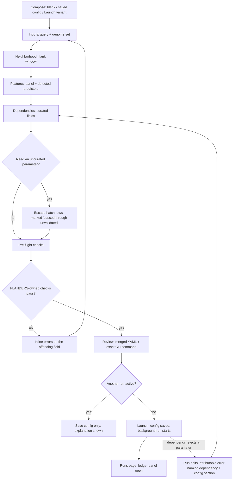
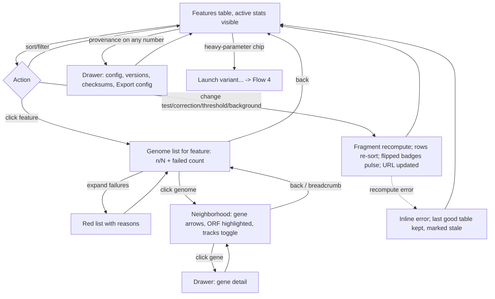
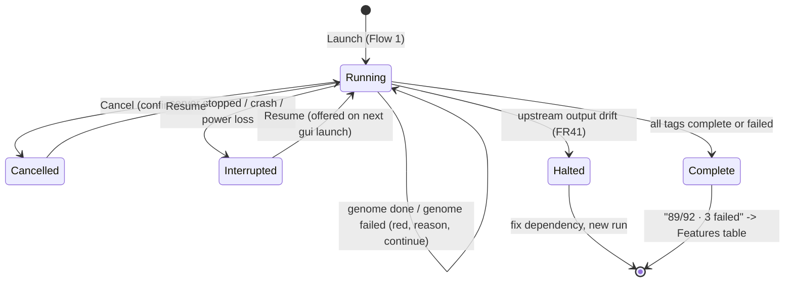
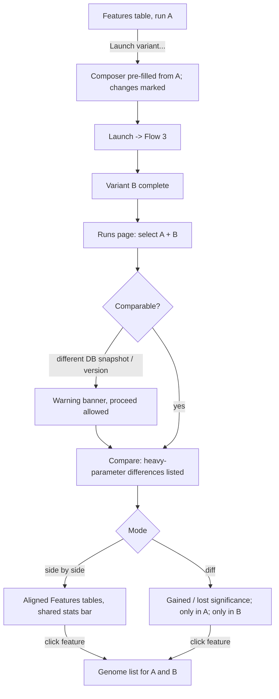
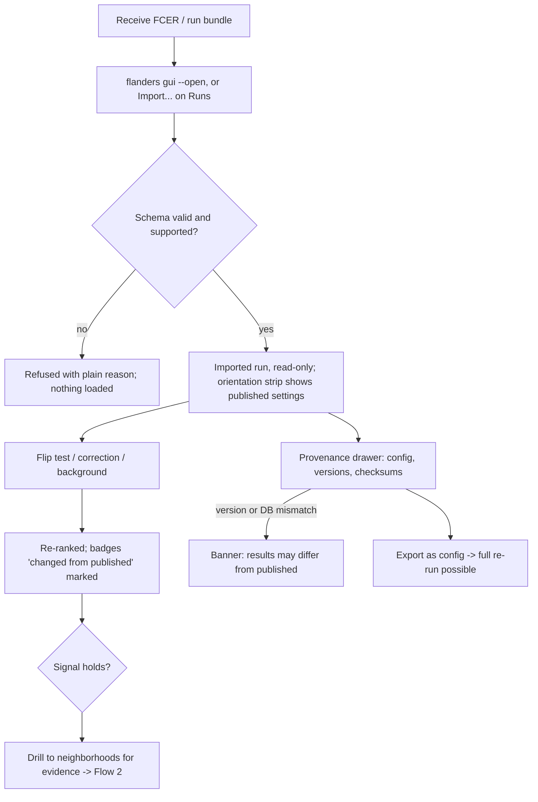

# UX Design Specification FLANDERS

**Author:** Kevin Klicki
**Date:** 2026-10-01

---

## Executive Summary

### Project Vision

The FLANDERS GUI is a local, notebook-feeling instrument for interrogating BGC neighborhood enrichment. cblaster, antiSMASH, and the feature predictors stay invisible: a user composes a run, launches it, watches it progress through the run ledger, then explores results aggregate-first — cross-genome enrichment, then individual genome neighborhoods — adjusting light-analytics parameters with immediate feedback. It is a desktop-scale browser app served from the user's own machine, and it is the author's primary instrument for discovering the questions the paper will ask.

### Target Users

- **Primary — the author and peer bioinformaticians.** Expert, CLI-comfortable, working on desktop or laptop monitors in long exploratory sessions during active research. They want notebook-like interactivity without writing notebook glue.
- **Secondary — the reviewer or collaborator.** Opens a shared FCER to check a claim, likely as a first-time user without reading documentation. Needs fast orientation, visible provenance, and re-analysis.
- **Not a v1 UX audience:** pipeline integrators (CLI only) and non-coding biologists (v2 hosted webapp).

### Key Design Challenges

1. **Two parameter classes that look alike but cost wildly differently.** Light-analytics parameters (significance threshold, statistical test, correction, background) recompute in moments from a saved FCER. Heavy parameters (flank window, cblaster identity and distance, antiSMASH settings, feature panel) require a full re-run measured in hours. A notebook-with-sliders feel invites treating them identically; the UI must make the cost boundary unmistakable — sliders live only on light parameters, and changing a heavy parameter puts results into an explicit *needs re-run* state.
2. **Aggregate-to-neighborhood drill-down at scale.** The aggregate view must stay scannable from 92 to ~1,000 genomes; the neighborhood view overlays four annotation layers (antiSMASH BGCs, signal peptides, transmembrane topology, Pfam domains) on a gene map without becoming cluttered.
3. **A multi-hour run inside a browser.** Runs last hours, tabs close, and the server may stop. The ledger panel must always be truthful about what is running, what failed and why, and what will resume.
4. **Provenance without noise.** Every number must be traceable to its configuration and dependency versions, yet provenance must not crowd the exploration surface.
5. **Free-form parameters must not look validated.** Escape-hatch dependency parameters receive no FLANDERS validation, and the UI must not imply otherwise.

### Design Opportunities

- **Live re-analysis as the signature interaction.** Drag the correction or threshold and watch the enrichment table re-rank — "what survives Bonferroni?" answered by moving a slider. The reviewer-verification story made tangible.
- **The ledger as a live narrative.** Per-genome rows update as the run proceeds, with failures in red and their reasons beside them. Zero silent exclusions (NFR9) becomes visible rather than merely documented.
- **Provenance one click from any number.** Any enrichment value opens the exact configuration, versions, and checksums behind it.
- **The composer as a teaching surface.** Curated dependency fields with plain-language labels let a peer configure cblaster correctly without reading its documentation.

### PRD Changes Pending

*Applied to the PRD on 2026-11-06 (`bmad-edit-prd`), together with FCER/bundle import, run bundles, and fresh-snapshot search; see the PRD's `editHistory`.*

- **The GUI may launch a heavy run** as a background process (one at a time, cancellable, with live ledger display). This reverses PRD FR60 and the corresponding statements in *CLI Tool Specific Requirements*, *Domain-Specific Requirements*, and *Product Scope*; run-from-UI moves from v2 into v1. The CLI remains the fully supported headless path. Stopping `flanders gui` stops the run; the ledger resumes it.
- **New capability — run history and comparison.** A user can browse the history of runs and compare any two, side by side or as a diff of enrichment outcomes (new FR).
- **Deferred — stage reuse across variant runs.** Reusing unchanged stages (cached cblaster searches, per-ORF predictions) keyed by inputs, tool version, and database checksum is a post-v1 candidate. Architecture should keep per-stage outputs in a reusable form so it can be added later.
- **Django replaces FastAPI** as the local server (reverses the brief/PRD "Backend: FastAPI (locked)").
- **Server-rendered Django templates + htmx replace the SPA.** "Pre-built SPA assets in the wheel" becomes compiled CSS; "the same SPA + FastAPI become the v2 webapp" becomes "the same Django app becomes the v2 webapp."
- **Workspace model.** User state lives in a host-side workspace directory (default `~/flanders/`) mounted into the container: a Django-managed SQLite database (ledger, run history, FCER index), configs, outputs, and FCERs. The image holds only code and frozen reference data. The database is a rebuildable index; FCERs remain the portable artifact.

## Core User Experience

### Defining Experience

**The core loop is interrogating the aggregate.** A user lands on the cross-genome enrichment table, adjusts light-analytics parameters and watches the ranking respond, then drills into individual genome neighborhoods to see what is driving a signal — which neighbors carry signal peptides, transmembrane helices, Pfam domains, or antiSMASH BGC hits — and returns to the aggregate with a sharper question. Composing, running, and provenance inspection exist to feed or justify this loop.

The interaction that must be right is **adjust → re-rank → drill → return**, fast enough to feel like thinking rather than submitting jobs.

Heavy-parameter exploration happens through **variant runs plus comparison**: the user launches a run with a changed heavy parameter and, when it finishes, compares it against the original to see which features gained or lost significance.

### Platform Strategy

- Desktop browser app served locally by `flanders gui`, which opens the browser automatically on launch.
- Mouse and keyboard; desktop and laptop screens (~1366px wide and up). No touch, mobile, or handheld targets.
- Current Chrome, Firefox, and Safari only.
- Fully functional offline once results exist; only remote-search runs need the network.
- Single user, single machine; one heavy run executes at a time.

### Effortless Interactions

- **Re-analysis is just a control change.** Changing test, correction, threshold, or background updates results in place — no submit step.
- **Drill-down keeps the user's place.** Opening a genome neighborhood and returning restores the aggregate's sort, filters, and scroll position.
- **Launching a run is one click from a composed config**; the ledger panel takes over from there.
- **Resuming is automatic.** Restarting `flanders gui` after an interruption surfaces the interrupted run and offers to resume it.
- **Past runs are always there.** Every finished run remains in a run list with its key parameters visible; selecting two shows them side by side or as a diff of significance changes.
- **Provenance is one click from any number** and otherwise stays out of the way.

### Critical Success Moments

- **First aggregate view of a finished run.** The enrichment table for all 92 genomes appears with corrected p-values and effect sizes, and what is worth chasing is immediately visible.
- **The first slider drag.** Switching BH to Bonferroni re-ranks the table live — the moment the tool reads as an instrument rather than a report generator.
- **A failure that doesn't hurt.** A genome fails mid-run, appears in red with its reason, and the run continues.
- **The reviewer's verification.** A first-time user opens a shared FCER, flips the test, and reaches a verdict without reading documentation.
- **Make-or-break failure:** re-analysis slow enough to break the thinking loop, or a GUI that loses track of a running job. Either sends the user back to a notebook.

### Experience Principles

1. **The aggregate is home.** Every view is reachable from it and returns to it.
2. **Cost is always visible.** Light parameters are live controls. Heavy parameters are visibly different: changing one marks results as needing a re-run, and the answer to "what if?" is a variant run plus comparison. Nothing pretends to be cheap.
3. **Never lose the user's place or their run.** Navigation state, run state, and failures survive tab closes, drill-downs, and server restarts.
4. **Show the evidence, not just the score.** Every enrichment value leads to the neighbors and annotations behind it, and to the provenance behind those.
5. **Failures are first-class.** Failed and excluded genomes are shown with reasons, never hidden or silently dropped.

## Desired Emotional Response

*Skipped at the author's direction — emotional-response goals are not a driver for this tool. The Experience Principles above govern.*

## UX Pattern Analysis & Inspiration

### Inspiring Products Analysis

- **Jupyter notebooks with interactive widgets** (the author's named reference). Direct manipulation of analysis parameters: a slider changes an input and the output updates. Weakness: hidden state — cells run out of order, outputs go stale silently, and nothing records what produced the current result.
- **Reactive notebooks (e.g., Observable).** Change an input and everything downstream recomputes automatically, so the display is never stale. The model for light-analytics re-analysis.
- **antiSMASH results pages.** An overview table of regions leads to a per-region detail view with a gene map and annotation tabs. The overview → detail hierarchy is right; the output is static — it cannot be re-parameterized, compared, or traced to its inputs.
- **clinker and cblaster plots.** Gene-cluster maps aligned across genomes, with homology links and function-coded color — the established visual language for neighborhoods in this field.
- **IGV and genome browsers.** Stacked annotation tracks on a shared coordinate axis, each independently toggleable — the proven answer to multiple annotation layers without clutter.

### Transferable UX Patterns

**Navigation**
- **Overview → detail → back** (antiSMASH): the aggregate table is the overview, a genome neighborhood is the detail, and the overview's state is preserved on return.
- **Run list as the top-level index:** every past run with its key parameters, with two selectable for comparison.

**Interaction**
- **Reactive recompute** (Observable): light-analytics controls trigger automatic re-ranking — no run button, no stale output.
- **Explicit staleness for heavy parameters:** where Jupyter fails silently, FLANDERS marks results needing a re-run and offers to launch a variant.
- **Toggleable annotation tracks** (IGV): antiSMASH, signal-peptide, transmembrane, and Pfam layers each switchable.

**Visual**
- **Gene-arrow neighborhood maps** in the clinker/cblaster idiom.
- **Color carries meaning only:** red for failures, one consistent palette for feature categories, one consistent encoding of significance throughout.

### Anti-Patterns to Avoid

- **Hidden or stale state** (Jupyter) — output is never shown without what produced it.
- **Static, dead-end reports** (antiSMASH HTML) — every view supports re-analysis and leads to provenance.
- **Wall-of-fields job forms** (Galaxy-style) — the composer shows curated parameters; everything else sits behind the escape hatch.
- **Silent failure summaries** ("89 genomes processed") that omit what happened to the rest.
- **Dashboard sprawl** — many competing panels when the aggregate table should be home.

### Design Inspiration Strategy

**Adopt:** reactive recompute for light parameters; antiSMASH-style overview → detail; clinker-style gene-arrow maps; IGV-style toggleable tracks.

**Adapt:** Jupyter's sliders — restricted to light parameters, with heavy parameters handled through variant runs plus comparison. antiSMASH's region detail — extended with live enrichment context and a provenance link.

**Avoid:** hidden state, static reports, wall-of-fields forms, invisible failures.

## Design System Foundation

### 1.1 Design System Choice

**Server-rendered Django templates, htmx for interactivity, Tailwind CSS for styling**, with Alpine.js for minimal client-only state (dropdowns, toggles, panel open/close). Components are reusable Django template partials on Tailwind, optionally with a CSS-only component layer (e.g., daisyUI) for standard controls. No SPA framework and no JavaScript component library.

### Rationale for Selection

- **One language, one codebase.** Statistics, the ledger, run history, and the UI live in Python and Django — the right scale for a solo developer.
- **Live re-analysis fits server-side.** Light analytics are already Python; a slider change goes to Django, the stats re-run, and the re-ranked table returns as a fragment swapped in place. Locally, the round-trip feels live.
- **No npm for anyone.** Compiled Tailwind CSS ships in the package and image; the build-time CSS step can use Tailwind's standalone binary.
- **Grows into v2.** The same Django app becomes the hosted webapp, with auth and users built in.

### Implementation Approach

- **State lives in the URL.** Aggregate sort, filters, and light-analytics settings are encoded in the query string, so drill-down and back restores the exact view and any view is bookmarkable.
- **Server-rendered tables** with sorting and filtering through htmx; ~1,000 rows render without client-side virtualization.
- **Server-rendered SVG neighborhood map**, with annotation tracks (antiSMASH, signal peptide, transmembrane, Pfam) toggled via htmx or CSS; minimal JS only if pan, zoom, or hover detail requires it.
- **Run ledger panel via htmx polling** (~2 s) against the SQLite ledger: per-genome rows, failures in red with reasons, progress counts.
- **Custom components** (specified in later steps): enrichment table, neighborhood map, ledger panel, run-comparison diff, provenance drawer, composer escape-hatch editor.

### Customization Strategy

- **Dense by default** — compact type, tight rows.
- **Semantic color tokens only:** *failure* (red), *warning*, *significant*, *not significant*, *stale / needs re-run*, plus one categorical palette for the four annotation layers.
- **Light and dark themes** from the same tokens.
- **No branding in v1** beyond the FLANDERS name.

### Workspace Model

All user state lives in a host-side workspace directory (default `~/flanders/`) mounted into the container: the SQLite database (ledger, run history, FCER index), run configs, outputs, and FCERs. The image contains only code and frozen reference data and is identical for every user. The `flanders` shim installed by `install-flanders.sh` performs the mount and binds the GUI port to `127.0.0.1`, so users never type Docker flags. The database is an index rebuildable by scanning the workspace's FCERs; FCERs and run bundles are what users share. The GUI's run list is the contents of the workspace.

**Architecture to verify:** SQLite reliability over macOS and WSL bind mounts (fallback: database in a Docker-managed volume, FCERs in the visible folder), and image size with the frozen reference snapshot.

## 2. Core User Experience

### 2.1 Defining Experience

**"Drag the statistics, watch the clade re-rank, click through to the genes."** The main page is a table of flank features — signal peptides, transmembrane helices, each Pfam domain, each antiSMASH BGC class — ranked by cross-genome enrichment. The user changes a light-analytics control and the ranking updates in place; clicks a feature to see which genomes carry it; clicks a genome to see the neighborhood itself — gene arrows, with the feature highlighted in context; then returns to the ranking exactly where they left it.

### 2.2 User Mental Model

- **Current practice:** cblaster output → antiSMASH HTML → hand-written SignalP/TMHMM loops → a pandas notebook joining everything → a custom enrichment script. The mental model is *a table of results I can re-slice, with the raw evidence one lookup away*.
- **Expectations:** spreadsheet-like table behavior (sort by any column, filter, click a row for detail) and antiSMASH- or clinker-style gene maps for neighborhoods.
- **Likely confusion:** (1) expecting heavy parameters to be live-adjustable; (2) not knowing which background or test produced the displayed numbers; (3) a feature in "85/92 genomes" when three genomes failed. Each is addressed in the mechanics below.

### 2.3 Success Criteria

- A light-analytics change re-ranks the table without a page reload and without losing sort, filter, or scroll position.
- The active statistical settings (test, correction, threshold, background) are always visible above the table; no number appears without its context.
- Genome counts always show the denominator and exclusions ("85/92", failed genomes counted and listed).
- Feature → genomes → neighborhood takes two clicks; back returns to the exact prior view (state in the URL).
- In a neighborhood, the ORF that made the genome count for the selected feature is highlighted.

### 2.4 Novel UX Patterns

Established patterns in a new combination; no user education required:
- Sortable, filterable data table (spreadsheet convention).
- Overview → detail drill-down (antiSMASH convention).
- Gene-arrow maps with annotation tracks (clinker / IGV conventions).

**The one novel element is live statistical re-ranking** — controls that change the *method*, not just the filter. The familiar metaphor is a filter control, with one explicit difference: rows do not disappear as the method changes; their significance badges flip and they re-sort, so the user sees the effect of the method choice rather than a shrinking list.

### 2.5 Experience Mechanics

**1. Initiation.** `flanders gui` opens the browser to the most recent run's Features table. If a run is in progress, a ledger summary bar appears above the table and expands into the full ledger panel.

**2. Interaction.**
- A **statistics bar** above the table holds the light-analytics controls: test (binomial / permutation), correction (BH / Bonferroni / none), significance threshold (slider), and background (paralog-collapsed / raw).
- **Table columns:** feature, genomes carrying it (n/N), effect size, raw p, corrected q, significance badge. All sortable; filterable by name or category.
- **Feature row click** opens the feature's genome list: each genome with location (upstream/downstream), contributing ORF, and per-genome evidence.
- **Genome click** opens the neighborhood view: gene-arrow map of seed cluster plus flanks, toggleable tracks (antiSMASH, signal peptide, transmembrane, Pfam), the selected feature's ORF highlighted, and hover detail (accession, product, annotations).

**3. Feedback.**
- A control change shows a brief inline "recomputing" state on the table only; re-ranked rows move to new positions and badges that flipped significance are briefly highlighted.
- Heavy parameters are absent from the statistics bar; they appear read-only in a run summary with a **Launch variant…** action that opens the composer pre-filled from the current run.
- Failed or excluded genomes appear as a count beside every denominator and expand into a red list with reasons.

**4. Completion.**
- From any view the user can open **provenance** (configuration, versions, checksums), **launch a variant run**, or **compare** against another run.
- The URL captures the complete view, so a finding can be bookmarked or pasted into notes and reopened exactly.

## Visual Design Foundation

### Color System

- **Base:** neutral slate scale for surfaces, borders, and text, plus one accent (teal) for interactive elements — links, focused controls, active tab. The data supplies the color.
- **Semantic tokens** (each paired with a label or icon; meaning never depends on color alone):

| Token | Use | Treatment |
|---|---|---|
| `significant` | Passes active correction and threshold | Filled accent badge ● |
| `not-significant` | Fails it | Gray outline badge ○ |
| `failure` | Failed or excluded genome or task | Red — reserved exclusively for failures |
| `warning` | Completed with warnings, low counts | Amber |
| `stale` | Results would change under edited heavy parameters | Amber dashed outline + "needs re-run" label |
| `flipped` | Badge changed significance on last recompute | Brief highlight pulse |

- **Annotation-track palette** (Okabe–Ito, colorblind-safe; red excluded): antiSMASH BGC `#E69F00` (orange), signal peptide `#56B4E9` (sky blue), transmembrane `#009E73` (bluish green), Pfam domain `#CC79A7` (reddish purple).
- **Gene arrows:** seed-cluster genes dark slate; flanking genes light gray; the ORF behind the selected feature gets an accent outline.
- Light and dark themes from the same tokens.

### Typography System

- **UI:** Inter (system UI stack fallback) — legible at small sizes, tabular numerals.
- **Monospace:** JetBrains Mono for accessions, parameters, config, provenance, and numeric columns.
- **Fonts are self-hosted in the image** — no CDN — so the GUI works fully offline.
- **Scale:** 12 / 13 / 14 / 16 / 20 / 24 px. Body 14, table cells 13, metadata and hover detail 12. Line height 1.4 body, 1.25 table rows.
- Tabular figures throughout; p-values in scientific notation (`3.1e-09`).

### Spacing & Layout Foundation

- **4 px base unit.** Table rows 28 px (compact), 36 px comfortable option; controls 32 px tall.
- **Page structure:**
  - Top nav: Features · Genomes · Runs · Compose, with current run name and status at right.
  - Statistics bar: sticky under the nav on results views, holding light-analytics controls.
  - Main area: full width for the table.
  - Right-side drawer: provenance and gene detail, overlaying rather than navigating away.
  - Ledger: slim bar under the nav while a run is active, expandable into a full panel.
- **Minimum width 1280 px**; no mobile breakpoints.

### Accessibility Considerations

Minimal by PRD decision, with near-free inclusions:
- Colorblind-safe annotation palette; no color-only meaning anywhere.
- Text contrast ≥ 4.5:1 in both themes.
- Visible keyboard focus; tables and drawers keyboard-operable (arrows move rows, Enter drills down, Esc closes drawer).
- Full accessibility work remains in the v2 hardening pass.

## Design Direction Decision

### Design Directions Explored

Six directions were prototyped in an interactive showcase (`ux-design-directions.html`) using an *ebo*-shaped run with live BH/Bonferroni recomputation: (1) **Spreadsheet** — sticky statistics bar over a full-width dense table; (2) **Notebook** — stacked reactive cells (controls, table, volcano, neighborhood); (3) **Split view** — table plus live evidence pane; (4) **Control rail** — fixed left settings rail; (5) **Plot-first** — volcano plot leading the table; (6) **Inline expand** — rows expand in place to show neighborhoods, dark, comfortable density.

### Chosen Direction

**Direction 1 — Spreadsheet**, as prototyped: top nav (Features · Genomes · Runs · Compose) with current run and status; a slim ledger bar while any run is active; a sticky statistics bar (test, correction, threshold slider, background) with the run's heavy parameters as read-only chips and **Launch variant…**; and a full-width compact table (28 px rows) of features ranked by enrichment, every column sortable, denominators showing exclusions ("85/89 · 3 failed"), significance badges that flip and briefly highlight on recompute.

Drill-down follows section 2.5: feature row → that feature's genome list → a genome's neighborhood view on its own page. Provenance and gene detail open in a right-side drawer.

### Design Rationale

- **Cleanest and most familiar:** spreadsheet behavior every target user already knows; only live re-ranking is new.
- **Maximum data on screen:** no rail, pane, or plot competes with the table — important as runs approach ~1,000 genomes and long feature lists.
- **Strongest fit with "the aggregate is home"** (Experience Principle 1): one primary surface.
- **Simplest Django + htmx build:** one server-rendered table fragment swaps on recompute; URL state handles sort, filter, and back navigation.

### Implementation Approach

- The Features page is a single htmx-swappable table fragment. Statistics-bar changes re-request only that fragment while the controls stay mounted, so the threshold slider remains usable mid-drag (an issue found and fixed in the prototype).
- Sort, filter, and statistical settings live in the URL query string.
- The ledger bar polls the SQLite ledger and expands into the full ledger panel.
- The genome list and neighborhood view are separate pages reusing the same nav, ledger bar, and statistics context, so a neighborhood is always viewed under the active statistical settings.
- Direction 1 in `ux-design-directions.html` is the visual reference for implementation.

## User Journey Flows

*Scope: GUI journeys only. PRD Journeys 3 (pipeline integrator) and 4 (maintainer) are CLI- and CI-only and have no GUI flow.*

**Decisions made in this step:**
- **Partial results during a run:** the cross-genome aggregate is hidden until the run finishes, because statistics on a partial genome set would mislead. Per-genome neighborhoods for finished genomes can be viewed, and the previous run stays fully browsable.
- **Opening a shared FCER:** `flanders gui --open <fcer-or-bundle>`, or **Import…** on the Runs page. Both copy the FCER into the workspace, where it appears as a read-only run marked **imported**.
- **Comparison basis:** both runs in a comparison are recomputed under the current statistics-bar settings, so the diff isolates the heavy-parameter change.

### Flow 1 — Compose and Launch a Run

**Goal:** go from a question to a running analysis without learning any cblaster or antiSMASH flag (PRD J1; FR52–FR55).

**Entry points:** **Compose** in the top nav (blank or from a saved config); **Launch variant…** from the statistics bar (pre-filled from the current run, see Flow 4); a config file already in the workspace.

**Mechanics:**
- The composer has four sections: **Inputs** (query FASTA or accessions; genome set as a local DB or remote search), **Neighborhood** (flank window), **Features** (SignalP, TMHMM, Pfam checkboxes, showing which predictor in the fallback chain is detected), and **Dependencies** (curated cblaster and antiSMASH fields with plain-language labels). Each dependency section has an **Advanced: pass-through parameters** key–value block.
- Escape-hatch rows are visibly marked **"passed through unvalidated"**. They are never styled like validated fields.
- **Pre-flight** checks only what FLANDERS owns: input files exist, the reference DB snapshot is present, predictors are detected, and the remote-search mode carries a non-reproducible notice (FR31).
- A **review panel** shows the effective merged YAML and the equivalent `flanders run -c …` command (FR54), so the GUI and CLI paths stay visibly identical (FR55).
- **Launch** saves the config into the workspace and starts the run as a background process. The view moves to the Runs page with the ledger panel open. Only one run can be active at a time; if one is already running, Launch becomes **Save config** and explains why.

### Flow 2 — Interrogate the Aggregate (core loop)

**Goal:** adjust → re-rank → drill → return, fast enough to feel like thinking (§2.1, §2.5).

**Entry points:** `flanders gui` opens the most recent finished run's Features table; any run in the Runs list; a bookmarked URL.

**Mechanics:**
- A statistics-bar change re-requests only the table fragment. Rows re-sort and flipped badges pulse. The URL updates.
- A feature row opens the genome list (location, contributing ORF, per-genome evidence). The denominator shows exclusions, which expand into a red list with reasons.
- A genome opens the neighborhood page with the contributing ORF highlighted and toggleable tracks. Hovering or clicking a gene opens gene detail in the drawer.
- Back, whether the browser button or the breadcrumb, restores sort, filter, statistical settings, and scroll from the URL.
- A **provenance** link next to any number opens the drawer with config, versions, checksums, and **Export as config**.
- A recompute failure shows an inline error on the table and keeps the last good table with a "stale" label. It never shows a blank table.

### Flow 3 — Monitor, Absorb Failures, Resume

**Goal:** the GUI never loses track of a run and never hides a failure (Experience Principles 3 and 5; FR45–FR50; NFR7–NFR9).

**Mechanics:**
- While a run is active, a **ledger bar** on every page shows the stage, done/failed/pending counts, and elapsed time. It expands into the **ledger panel**: per-genome rows by stage, with failures in red and their reasons, and a filter for failed rows.
- **Per-genome failure:** recorded, shown in red, and the run continues. Failures are never retried automatically, and the ledger says so.
- **Upstream format drift (FR41):** the whole run **halts** with a distinct "halted — dependency output not parseable" state naming the dependency and version. No FCER is emitted. This state looks different from a per-genome failure.
- **Cancel:** confirmed, then the ledger keeps the completed tasks. The run is listed as *cancelled · resumable*.
- **Tab closed:** the run continues, and reopening the GUI shows the ledger bar again.
- **Server stopped** (`flanders gui` exits, machine sleeps, power loss): the run stops. On the next launch, a banner reads *"Run X was interrupted at 61/92 genomes"* with **Resume** and **Dismiss** buttons. Resume repeats only in-flight tasks (NFR7).
- **Completion:** the ledger bar turns into a *"Run complete — 89/92 · 3 failed"* notice, which links to the Features table.
- **Partial results:** the aggregate stays hidden until completion; finished genomes' neighborhoods can be viewed from the ledger panel.

### Flow 4 — Variant Run and Compare

**Goal:** answer a "what if?" about a heavy parameter honestly, with a re-run plus comparison (Experience Principle 2).

**Mechanics:**
- **Launch variant…** opens the composer pre-filled from the current run, named `<run>-variant-n`. Edited fields are marked *changed from <run>*.
- The source run stays fully browsable while the variant runs (Flow 3).
- On the **Runs** page, every run is listed with its key parameters, status, date, and whether it was imported. Selecting two enables **Compare**.
- **Compare** opens in two modes: **side by side** (two Features tables with aligned rows) or **diff** (only features whose significance or rank changed, grouped as *gained significance*, *lost significance*, *only in A*, *only in B*). A header lists the heavy parameters that differ between the runs.
- Both runs are recomputed under the current statistics bar, so the diff reflects only the heavy-parameter change.
- If the runs used different reference DB snapshots or FLANDERS versions, a warning banner says so. Comparison is still allowed.

### Flow 5 — Reviewer Verifies a Shared FCER

**Goal:** a first-time user reaches an independent verdict without reading documentation (PRD J2; FR34, FR36–FR37).

**Entry:** `flanders gui --open <fcer-or-bundle>`, or **Import…** on the Runs page. Either way the FCER is copied into the workspace and opens as a read-only run marked **imported**.

**Mechanics:**
- On first open, an **orientation strip** above the statistics bar gives the claim context: run name, genome count, the test and correction it was published with, and a provenance link. It can be dismissed and is remembered per run.
- The reviewer flips the test or correction. The table re-ranks, and badges that changed from the published verdicts are marked **changed from published** (distinct from the transient flip pulse).
- Provenance shows the full configuration, versions, and checksums. If the reviewer's FLANDERS release or DB snapshot differs from the FCER's, a banner says so.
- **Export as config** produces a runnable YAML for a full pipeline re-run (FR36).
- An FCER with a newer schema major version, or one that is invalid, is refused at import with a plain reason. It is never partially loaded.

### Journey Patterns

**Navigation**
- **Hub and spoke from the aggregate:** every flow starts at or returns to a Features table (Principle 1).
- **URL is state:** every view, including comparisons, is reconstructable from its URL.
- **Drawers for context, pages for depth:** provenance and gene detail overlay; genome lists and neighborhoods are pages.

**Decision**
- **Light vs heavy is a structural choice, not a warning:** light parameters are live controls, and heavy parameters are only reachable through Launch variant.
- **Validated vs unvalidated is visible:** escape-hatch and pass-through inputs carry a persistent marker.
- **Destructive or long actions confirm once** (Cancel, Resume after interruption); everything else is immediate.

**Feedback**
- **Three distinct failure grades:** per-genome failure (red row, run continues), run halted (drift, a distinct state), and interrupted (resumable banner). They never share one visual treatment.
- **Denominators everywhere:** `n/N · k failed`, with the failed count expandable.
- **Change is marked by its cause:** *flipped* (last recompute), *changed from published* (reviewer), *changed from <run>* (variant composer), *stale* (results no longer match the parameters).

### Flow Optimization Principles

- **Zero-step re-analysis:** no submit buttons on light parameters.
- **One click from a composed config to a running job;** the ledger takes over without further navigation.
- **Pre-fill instead of re-entry:** variants start from the source run, and exports start from provenance.
- **Failures never block the healthy path:** a failed genome never stops the run or hides the aggregate; only output-format drift halts.
- **Recovery is offered, not required:** interrupted runs surface themselves on the next launch.
- **First-time orientation without docs:** imported FCERs open with their published settings visible and a provenance link one click away.

## Component Strategy

**Decisions made in this step:**
- **No daisyUI.** About ten generic controls are needed, all at 28–32 px density, tighter than daisyUI's defaults; adopting it would add a second theming system beside the semantic tokens. Generic controls are hand-rolled Tailwind partials.
- **Neighborhood map is a project-owned, server-rendered SVG template.** pyGenomeViz and clinker target publication figures, not interactive htmx fragments; they remain candidates for a later "export figure" feature. Final call belongs to `bmad-create-architecture`.

### Design System Components

Built as Tailwind template partials over the semantic tokens. Each is a Django include with a small, documented context.

| Partial | Used for |
|---|---|
| Button (primary, secondary, ghost, danger) | Launch, Resume, Export, Cancel |
| Select, segmented control | Test, correction, background |
| Range slider with numeric readout | Significance threshold |
| Checkbox, toggle | Feature panel, annotation tracks |
| Text, number, file-path input | Composer fields |
| Tabs | Compare modes, drawer sections |
| Breadcrumbs | Run › Feature › Genome |
| Tooltip | Hover detail, heavy-parameter chip explanations |
| Drawer shell (right side, Esc to close) | Provenance, gene detail |
| Confirm dialog | Cancel run, Resume |
| Banner (info, warning, failure) | Interrupted run, version mismatch, refused import |
| Code block with copy | YAML, CLI command, checksums |

Alpine.js handles only client-local state: drawer open/close, dropdowns, the flip-pulse timer, and copy-to-clipboard.

### Custom Components

#### 1. Enrichment Table

**Purpose:** the home surface. Features ranked by cross-genome enrichment under the active statistics.
**Usage:** the Features page; reused for the genome list (different columns) and for both compare modes.
**Anatomy:** sticky header with sort indicators and filter input · rows of feature name (with category dot), `n/N · k failed` denominator cell, effect size, raw p, corrected q, significance badge, provenance link · footer with row count and active settings.
**States:** default · recomputing (inline indicator on the table only, rows still visible) · just-recomputed (rows animate to new positions, flipped badges pulse about 1.5 s) · stale (last good table kept, dashed amber outline, error message) · empty (no features pass a filter; filter text shown with a clear action) · unavailable (run still in progress; links to the ledger and to finished neighborhoods).
**Variants:** `features` (default) · `genomes` (genome, location, contributing ORF, per-genome evidence) · `compare-side-by-side` (two tables with aligned rows) · `compare-diff` (grouped as gained, lost, only in A, only in B).
**Accessibility:** a real `<table>` with `aria-sort`; arrow keys move the row focus and Enter drills down; the recompute state is announced through `aria-live="polite"`.
**Interaction:** a single htmx fragment target. Sort, filter, and statistics live in the query string (`hx-push-url`). Scroll position is restored on back.

#### 2. Statistics Bar

**Purpose:** the light-analytics controls, with the run's heavy parameters visibly kept apart.
**Anatomy:** left side: test (segmented), correction (segmented), threshold (slider plus readout), background (select). Right side: heavy-parameter chips (read-only, monospace) and **Launch variant…**.
**States:** default · recomputing (controls stay usable; the slider is never disabled mid-drag) · imported run (the orientation strip appears above it showing the published settings, with a **Reset to published** action) · compare mode (one bar drives both runs).
**Accessibility:** every control is labelled; slider steps are keyboard-adjustable; the chips' tooltips explain "changing this requires a re-run."
**Interaction:** changes trigger a debounced htmx request for the table fragment only (`hx-sync` drops in-flight requests, so the last value wins).

#### 3. Significance Badge and Denominator Cell

**Purpose:** the two small parts that carry the most meaning, kept identical everywhere.
**Badge states:** significant ● (filled accent) · not significant ○ (gray outline) · flipped (transient pulse) · changed from published (persistent marker plus tooltip giving the published verdict).
**Denominator:** `85/92 · 3 failed`. The failed count is a button that expands an inline red list of genomes with reasons. It shows as `92/92` when nothing failed and is never hidden.
**Accessibility:** the badge text is always present (screen-reader text "significant at q < 0.05"); meaning never depends on color alone.

#### 4. Neighborhood Map

**Purpose:** the evidence behind a feature, shown as the genes themselves.
**Anatomy:** a shared coordinate axis (kb) · a gene-arrow row (strand-directed; seed cluster dark slate, flanks light gray, contributing ORF with an accent outline) · stacked toggleable tracks (antiSMASH BGC regions, signal peptide, transmembrane segments, Pfam domains, in Okabe–Ito colors) · a legend with track toggles · an upstream/downstream label · a scale bar.
**States:** default · gene hovered (tooltip with accession, product, annotations) · gene selected (drawer opens with gene detail) · track hidden · partial annotation (a predictor failed for this genome; the track shows a hatched "not available" segment with the reason, never a silent gap).
**Accessibility:** each gene is a focusable SVG group with `aria-label`; Tab or arrow keys move between genes and Enter opens detail; a companion **gene table** toggle presents the same data as a table.
**Interaction:** rendered server-side by a Django template from FCER coordinates; toggling a track is CSS only. Pan and zoom are not in v1. Flank windows fit the page width, and long neighborhoods scroll horizontally inside the map.

#### 5. Ledger Bar and Ledger Panel

**Purpose:** a truthful, always-visible account of the active run.
**Bar anatomy:** run name · stage · progress (`61/92 done · 2 failed · 29 pending`) · elapsed time · expand control · Cancel.
**Panel anatomy:** per-genome rows (accession, stage reached, status, reason) · filter (all, failed, in progress) · a note that failures are not retried · a link to finished genomes' neighborhoods.
**States:** running · cancelled (resumable) · interrupted (shows as a banner on the next launch: *"Run X was interrupted at 61/92 genomes"* with Resume and Dismiss) · halted (a distinct failure-colored treatment: *"Halted: antiSMASH 7.1 output could not be parsed. No results were emitted."*) · complete (a *"Run complete — 89/92 · 3 failed"* notice linking to Features) · idle (hidden).
**Accessibility:** progress uses `role="progressbar"`; status changes go through `aria-live="polite"`, and halted goes through `assertive`.
**Interaction:** htmx polls the ledger about every 2 s while the run is active and stops polling when no run is active.

#### 6. Provenance Drawer

**Purpose:** every number traceable, one click away, otherwise out of sight.
**Anatomy:** tabs for **Config** (the effective merged YAML, with pass-through parameters marked unvalidated), **Versions** (FLANDERS plus each dependency), **Databases** (names, snapshot IDs, checksums), and **Analyzers** (which predictors and tests ran, including fallback substitutions) · an **Export as config** action · a citation string with copy.
**States:** default · mismatch (a warning banner when the local FLANDERS or DB snapshot differs from the FCER's) · non-reproducible (a banner for remote-search runs, FR31).
**Accessibility:** focus is trapped while open; Esc closes it and returns focus to the triggering number.

#### 7. Run Composer

**Purpose:** a complete run configuration without learning any dependency flags.
**Anatomy:** four sections (Inputs, Neighborhood, Features, Dependencies) on one scrolling page with a section index · curated fields with plain-language labels and the upstream flag name in small monospace · an **escape-hatch editor** (key–value rows with add and remove, each row tagged *passed through unvalidated*) · a pre-flight results list · a **review panel** with the merged YAML and the exact `flanders run -c …` command.
**States:** blank · pre-filled from a variant (changed fields marked *changed from <run>*) · pre-flight errors (inline on fields plus a summary) · another run active (Launch becomes **Save config** with an explanation) · launching.
**Accessibility:** native form controls with labels; errors linked through `aria-describedby`; the escape-hatch rows are keyboard-operable.

#### 8. Run List and Compare Selector

**Purpose:** the workspace's run history and the way into comparison.
**Anatomy:** a table of runs (name, status, date, genome count, key heavy parameters, imported/local tag) · row checkboxes · a **Compare** action, enabled when exactly two are selected · **Import…** · a comparability banner on the compare view (different DB snapshot or FLANDERS version).
**States:** default · one selected · two selected (Compare enabled) · import refused (failure banner with a plain reason).

### Component Implementation Strategy

- **Every component is a Django template partial** with a documented context contract. An htmx-swappable component is its own fragment endpoint, so the same template renders the full page and the swapped fragment.
- **Tokens, not colors:** components reference only semantic tokens (`significant`, `failure`, `stale`, and so on) and the track palette. Light and dark themes come from the token layer alone.
- **One source per primitive:** the significance badge, denominator cell, and banner exist once and are included everywhere, so their meaning cannot drift between views.
- **Server owns state, Alpine owns only the ephemeral:** anything worth bookmarking lives in the URL; anything lost on reload (drawer open, hover) lives in Alpine.
- **Built against fixture FCERs first** (PRD v1 development sequence), so the results components work before the pipeline runs end to end.
- **A component gallery page** (`/_components`, debug only) renders every component in every state from fixtures. It serves as the visual regression reference and as the UI-led development surface.

### Implementation Roadmap

**Phase 1: Results against fixtures** (unblocks UI-led exploration with no pipeline)
- Design-system partials and the token layer
- Significance badge and denominator cell
- Enrichment table (`features` and `genomes` variants)
- Statistics bar (light controls; heavy chips read-only)
- Neighborhood map
- Provenance drawer, including Export as config

**Phase 2: Running** (once the pipeline can execute)
- Run composer, including the escape-hatch editor and review panel
- Ledger bar and panel, in all run states
- Interrupted-run banner and resume

**Phase 3: History and verification**
- Run list and compare selector, Import…
- Enrichment table `compare-side-by-side` and `compare-diff` variants
- Orientation strip and "changed from published" badge state for imported runs

## UX Consistency Patterns

**Decisions made in this step:** composer drafts autosave to the workspace; *failed* and *excluded* are distinct, defined terms. Mobile considerations are not applicable (desktop-only, 1280 px minimum).

### Button Hierarchy

- **One primary action per view:** Launch on the composer, Compare on the Runs page, Export as config in the provenance drawer. The Features page has no primary button, because its main action is the statistics controls.
- **Heavy actions are labelled as heavy.** Launch, Launch variant…, and Resume carry a clock icon and the label suffix "· re-runs pipeline". No light-analytics change is ever behind a button.
- **Danger style is reserved** for Cancel run. Nothing in the GUI deletes user data in v1.
- **Secondary and ghost** for everything else (Copy, Reset to published, Import…). Icon-only buttons always have a tooltip and `aria-label`.

### Feedback Patterns

- **Severity ladder, by color token:** info (slate) · complete (accent) · warning (amber) · failure (red, reserved exclusively for failures) · stale (amber dashed). There is no separate "success green"; completion uses the accent.
- **Placement follows scope:** a message appears at the point of cause (a field, a row, the table) whenever possible. Page-level banners are used only for state that spans the page (interrupted run, version mismatch, halted run, refused import).
- **No toasts for anything that matters.** The only transient toast is "Copied." Failures and warnings persist until resolved or dismissed.
- **Message shape:** what happened · what it affects · what to do. Messages name the dependency and config section where relevant, e.g. *"antiSMASH rejected `--genefinding-tool prodigl` (from `antismash:` in the config). Fix the value in Dependencies → antiSMASH."* Raw tracebacks sit behind a **Details** expander that also shows the log path.
- **Change markers are by cause:** *flipped*, *changed from published*, *changed from <run>*, *stale*. Each has one visual treatment used everywhere.

### Form Patterns

- **Labels above fields** in plain language. The upstream flag name sits beneath in small monospace (`--min-identity`) so experts can map fields to the CLI.
- **Defaults are explicit:** an untouched field shows its value and its source (`30 · FLANDERS default`). An overridden field shows `· set in this run`.
- **Validation timing:** FLANDERS-owned fields validate on blur and again at pre-flight. Typing is never blocked, and errors never appear while the user is still typing.
- **Unvalidated is permanent and visible:** every escape-hatch row carries its *passed through unvalidated* tag at all times, not only on hover.
- **Drafts autosave** to the workspace (`~/flanders/drafts/`) and reappear under Compose → Drafts.
- **No multi-step wizard.** The composer is one scrolling page with a section index, so experts can jump directly to any section.

### Navigation Patterns

- **Top nav:** Features · Genomes · Runs · Compose, with a **run switcher** at the right showing the current run name and status. Switching run keeps the current statistics settings where they apply.
- **Breadcrumbs** on depth pages: `Run › Feature › Genome`.
- **The URL is the state:** sort, filter, statistics, compare pair, and the selected feature or genome. Browser back and forward always work and restore scroll.
- **Drawers are not history entries.** Esc or the close button dismisses them; Back always navigates pages.
- **Every page shows its context:** which run and which statistical settings, so a screenshot is never ambiguous.

### Additional Patterns

**Overlays**
- Drawers for context (provenance, gene detail); pages for depth (genome list, neighborhood).
- Confirm dialogs only for Cancel run and Resume after interruption. No modal forms, and no stacked overlays.

**Loading and empty states**
- **Never a blank or full-page spinner for a fragment.** The previous content stays visible with an inline "recomputing" indicator; on error it stays with a *stale* marker.
- **First launch, no runs:** the Runs page offers three entries: **Compose a run**, **Import an FCER**, and **Open the *ebo* reference corpus** (FR65).
- **Run in progress, no aggregate yet:** the Features page explains why and links to the ledger and to finished neighborhoods.
- **Filter matches nothing:** the filter text is shown with a one-click clear. A filter never alters denominators.

**Search and filtering**
- Name substring filter plus category chips (signal peptide, transmembrane, Pfam, antiSMASH class). The active filters and the result count are always shown, and filters live in the URL.
- Filtering hides rows only. It never changes the statistics; multiple-testing correction always applies to the full feature set, and the footer says so.

**Data display**
- p and q in scientific notation with two significant figures (`3.1e-09`); effect sizes to two decimals; all numerals tabular and right-aligned.
- Accessions, parameters, and checksums in monospace, truncated in the middle with the full value on hover and copy.
- Denominators always as `n/N · k failed · j excluded`, omitting zero terms after the first.

**Terminology** (used identically in the UI, CLI, and docs)
- **Run:** one execution of a config. **Variant:** a run launched from another run's config. **Imported run:** a run read in from a shared FCER, read-only.
- **Feature:** a testable flank property (a signal peptide, transmembrane helices, a Pfam domain, an antiSMASH BGC class). **Neighborhood:** the seed cluster plus its flanks in one genome.
- **Failed:** a task errored for a genome (it has a reason and is not retried). **Excluded:** an analysis rule removed the genome (it has a reason). Both are always listed, never silent (NFR9).
- **Light parameters:** test, correction, threshold, background. **Heavy parameters:** everything that requires a re-run.

**Keyboard**
- `/` focuses the filter · ↑/↓ moves rows · Enter drills down · Esc closes the drawer · `[` / `]` step the threshold · `?` opens the shortcut overlay.
- No single-key shortcuts fire while focus is in a text input.

**Design-system integration rules**
- Patterns are implemented once in the shared partials (badge, denominator, banner, field) and never re-styled locally.
- New states get a semantic token before they get a color.

## Responsive Design & Accessibility

*Decided by the facilitator at the author's direction ("whatever you think is best"), consistent with the PRD's minimal-accessibility v1 stance and the desktop-only platform strategy.*

### Responsive Strategy

- **Desktop only.** Target screens are laptops and desktop monitors, mouse and keyboard. No tablet, touch, or mobile layouts in v1.
- **Extra width goes to data, not chrome:** wider screens show more table columns without truncation and a wider neighborhood map. Layout structure (nav, ledger bar, statistics bar, full-width main area, overlay drawer) never changes.
- **Below the minimum width** the page scrolls horizontally rather than reflowing; nothing is hidden.

### Breakpoint Strategy

- **Desktop-first, two breakpoints only:**
  - **1280 px (minimum):** compact layout; the statistics bar wraps its heavy-parameter chips into a "+n more" overflow; side-by-side compare stacks the two tables vertically.
  - **≥ 1600 px (wide):** side-by-side compare shows the tables truly side by side; the provenance drawer widens.
- No mobile or tablet breakpoints.

### Accessibility Strategy

- **Target: WCAG 2.2 AA where it is near-free, not certified.** Formal compliance and assistive-technology testing are part of the v2 hardening pass for the non-coder audience (PRD *Browser & Performance Considerations*).
- **Committed for v1:**
  - Text contrast ≥ 4.5:1 and UI-component contrast ≥ 3:1 in both themes.
  - No color-only meaning (badges carry text; tracks carry labels; failures carry the word "failed").
  - Colorblind-safe Okabe–Ito track palette.
  - Full keyboard operation of the core loop: statistics bar, table, drill-down, drawers, composer.
  - Visible focus rings; focus trapped in and restored from drawers and dialogs.
  - Semantic HTML (`<table>`, `<label>`, `<button>`, landmarks); `aria-live` for recompute and run status.
  - A gene-table alternative to the neighborhood map.
  - `prefers-reduced-motion` disables row-reorder animation and the flip pulse (a static marker remains).
- **Not committed for v1:** screen-reader-optimized navigation of large tables, high-contrast mode, skip links, touch target sizes.

### Testing Strategy

- **Browsers:** current Chrome, Firefox, and Safari, at 1280 px and 1920 px, against the component gallery and the *ebo* fixture run.
- **Automated accessibility:** axe-core run over every component-gallery state in CI; contrast checks on the token layer for both themes.
- **Keyboard smoke test:** the core loop (change correction → drill to a neighborhood → open provenance → return) completed keyboard-only, as a scripted end-to-end test.
- **Colorblind check:** gallery screenshots run through deuteranopia and protanopia simulation once, when the palette is implemented.
- **No assistive-technology or disabled-user testing in v1** (deferred to v2 hardening).

### Implementation Guidelines

- Use `rem` for type and spacing so browser zoom works; fixed pixel values only for row height and hairlines.
- Desktop-first media queries at the two breakpoints above; no others.
- Every interactive element is a native control or has an explicit role, label, and keyboard handler.
- htmx swaps preserve focus: after a table recompute, focus returns to the control that triggered it; after a drill-down, focus lands on the page heading.
- Animations are CSS-only and wrapped in `prefers-reduced-motion` guards.
- The component gallery is the accessibility test surface: every new component state is added there before use.
