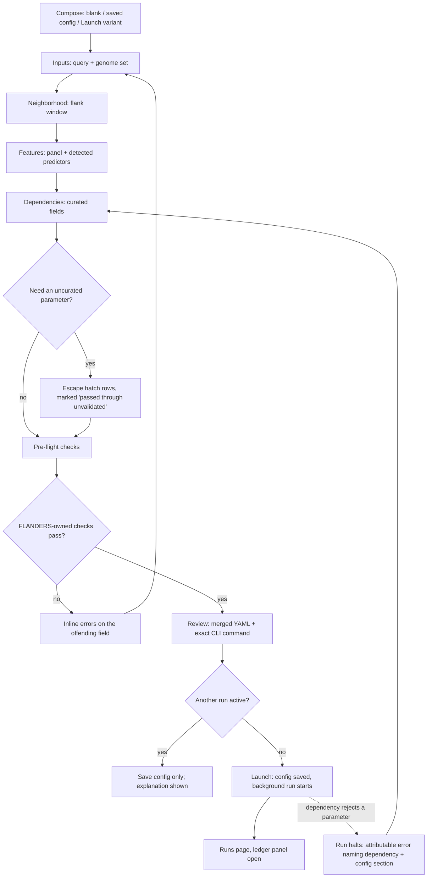
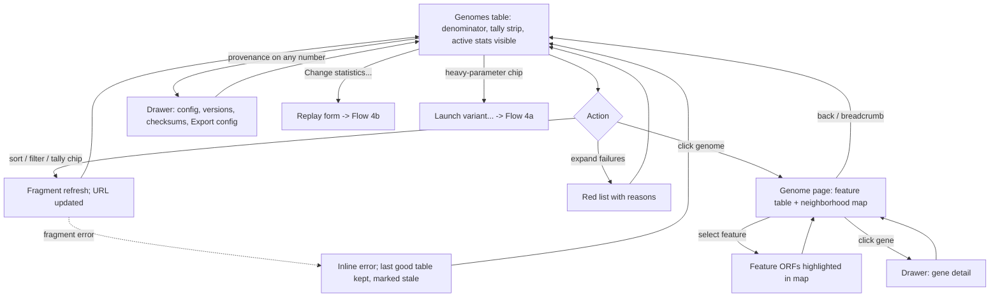
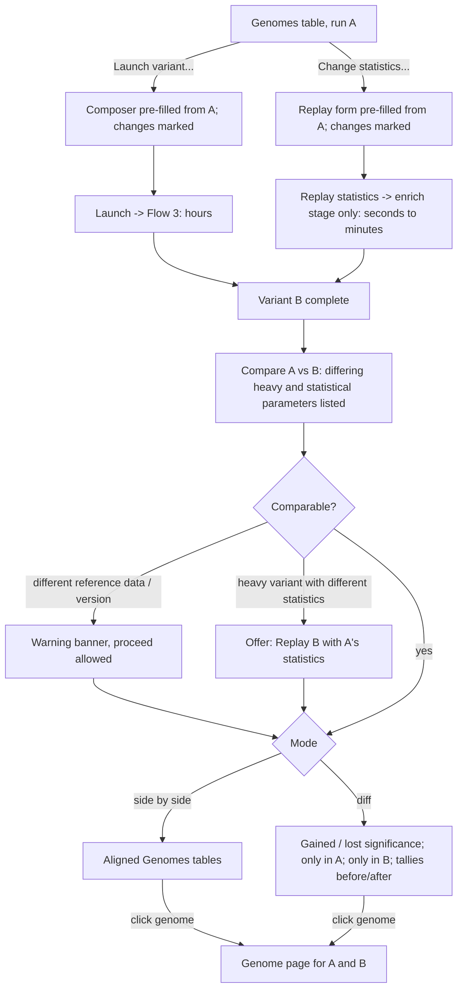
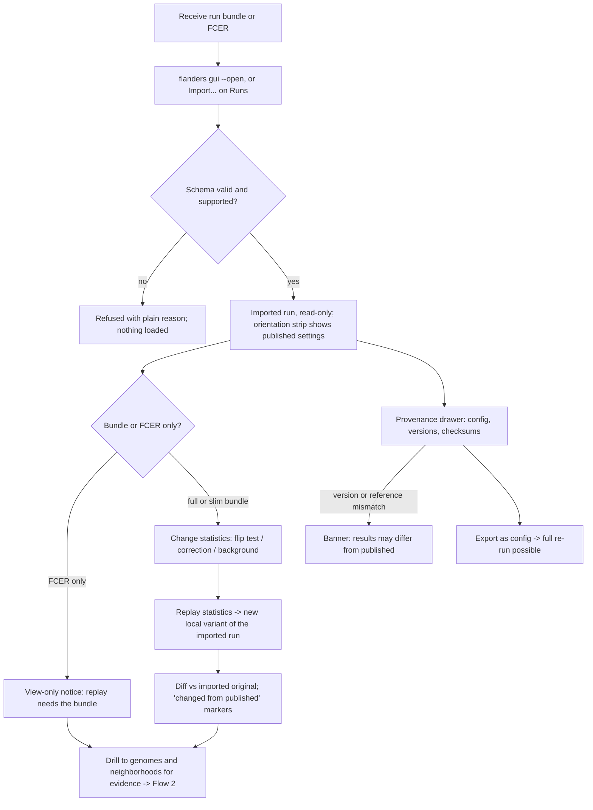
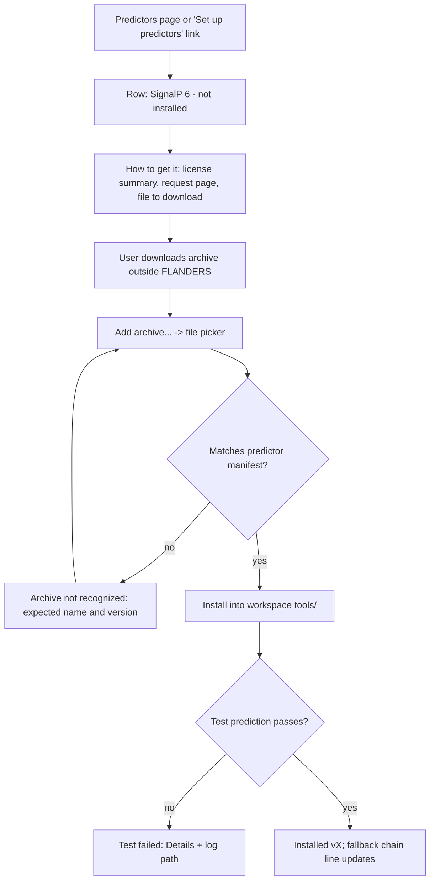

# UX Design Specification FLANDERS

**Author:** Kevin Klicki
**Date:** 2026-10-01

---

## Executive Summary

### Project Vision

The FLANDERS GUI is a local instrument for interrogating BGC neighborhoods genome by genome. cblaster, antiSMASH, and the feature predictors stay invisible: a user composes a run, launches it, watches it progress through the run ledger, then explores the results — every genome that carries a hit to the query cluster, each with its own flank-feature enrichment and its gene neighborhood. Changing the statistics is a cheap, recorded replay rather than an in-place edit, so every result on screen is a run that exists in the workspace. It is a desktop-scale browser app served from the user's own machine, and it is the author's primary instrument for discovering the questions the paper will ask.

### Target Users

- **Primary — the author and peer bioinformaticians.** Expert, CLI-comfortable, working on desktop or laptop monitors in long exploratory sessions during active research. They want notebook-like interactivity without writing notebook glue.
- **Secondary — the reviewer or collaborator.** Opens a shared FCER to check a claim, likely as a first-time user without reading documentation. Needs fast orientation, visible provenance, and the ability to replay the statistics from a shared run bundle.
- **Not a v1 UX audience:** pipeline integrators (CLI only) and non-coding biologists (v2 hosted webapp).

### Key Design Challenges

1. **Three kinds of change that cost very different amounts.** *View settings* (sort, filter, track toggles) are instant. *Statistical settings* (test, correction, threshold, background) are a **statistics replay**: only the enrichment stage re-runs, in seconds to minutes, and the result is a new variant run. *Heavy parameters* (flank window, cblaster identity and distance, antiSMASH settings, feature panel) are a full variant run measured in hours. The UI must make each cost visible and never present a replay or re-run as an in-place tweak.
2. **Genome-to-neighborhood drill-down at scale.** The Genomes table must stay scannable from 92 to ~1,000 genome × location rows; the neighborhood view overlays four annotation layers (antiSMASH BGCs, signal peptides, transmembrane topology, Pfam domains) on a gene map without becoming cluttered.
3. **A multi-hour run inside a browser.** Runs last hours, tabs close, and the server may stop. The ledger panel must always be truthful about what is running, what failed and why, and what will resume.
4. **Provenance without noise.** Every number must be traceable to its configuration and dependency versions, yet provenance must not crowd the exploration surface.
5. **Free-form parameters must not look validated.** Escape-hatch dependency parameters receive no FLANDERS validation, and the UI must not imply otherwise.
6. **Descriptive tallies must not read as a test.** Counts such as "signal peptide significant in 34/89 genomes" summarize per-genome verdicts; v1 performs no cross-genome statistical test, and the UI must say so wherever a tally appears.
7. **Restricted predictors the user must obtain.** SignalP 6, SignalP 5, TMHMM 2.0c and Phobius cannot ship in the image. Setup must explain licensing plainly and make installing a downloaded archive a single, verified step.

### Design Opportunities

- **Replay-and-compare as the signature interaction.** Switch BH to Bonferroni, replay the statistics, and land on a diff of which features gained or lost significance — "what survives Bonferroni?" answered with a recorded, comparable run rather than a transient view. The reviewer-verification story made tangible.
- **The ledger as a live narrative.** Per-genome rows update as the run proceeds, with failures in red and their reasons beside them. Zero silent exclusions (NFR9) becomes visible rather than merely documented.
- **Provenance one click from any number.** Any enrichment value opens the exact configuration, versions, and checksums behind it.
- **The composer as a teaching surface.** Curated dependency fields with plain-language labels let a peer configure cblaster correctly without reading its documentation.

### PRD Changes Pending

*Applied to the PRD on 2026-11-06 (`bmad-edit-prd`), together with FCER/bundle import, run bundles, and fresh-snapshot search; see the PRD's `editHistory`.*

- **The GUI may launch a heavy run** as a background process (one at a time, cancellable, with live ledger display). This reverses PRD FR60 and the corresponding statements in *CLI Tool Specific Requirements*, *Domain-Specific Requirements*, and *Product Scope*; run-from-UI moves from v2 into v1. The CLI remains the fully supported headless path. Stopping `flanders gui` stops the run; the ledger resumes it.
- **New capability — run history and comparison.** A user can browse the history of runs and compare any two, side by side or as a diff of enrichment outcomes (new FR).
- **Deferred — stage reuse across variant runs.** Reusing unchanged stages (cached cblaster searches, per-ORF predictions) keyed by inputs, tool version, and database checksum is a post-v1 candidate. Architecture should keep per-stage outputs in a reusable form so it can be added later.
- **Django replaces FastAPI** as the local server (reverses the brief/PRD "Backend: FastAPI (locked)").
- **Server-rendered Django templates + htmx replace the SPA.** "Pre-built SPA assets in the wheel" becomes compiled CSS; "the same SPA + FastAPI become the v2 webapp" becomes "the same Django app becomes the v2 webapp."
- **Workspace model.** User state lives in a host-side workspace directory (default `~/flanders/`) mounted into the container: a Django-managed SQLite database (ledger, run history, FCER index), configs, outputs, and FCERs. The image holds only code and frozen reference data. The database is a rebuildable index; FCERs remain the portable artifact.

### Architecture Validation Changes (2026-11-25)

*Decided with the author during architecture validation (2026-11-18..22) and applied to the PRD on 2026-11-25; this revision brings the UX in line.*

- **No cross-genome aggregate in v1.** Each FCER covers one genome × location. The home view is the **Genomes** table — one row per genome × location with a hit to the query cluster — and drill-down goes to that genome's feature enrichment and neighborhood. Cross-genome counts appear only as clearly labeled descriptive tallies of per-genome verdicts. Pan-genome analytics are post-v1.
- **Statistics changes are replays.** Every statistical setting, including the significance threshold, is changed through a **statistics replay**: a background stats-only run of the enrichment stage that creates a variant run, then opens a comparison with its source. Nothing recomputes inside a page request; the earlier "live re-ranking" interaction is withdrawn.
- **Reviewers verify from a bundle.** A full or slim run bundle carries the enrichment inputs needed to replay statistics; an FCER imported on its own is view-only.
- **Predictor setup.** Only DeepSig ships in the image. The installer, `flanders tools add`, and a GUI **Predictors** page install user-downloaded SignalP 6, SignalP 5, TMHMM 2.0c and Phobius archives.
- **Inputs are captured.** Files chosen in the composer's file picker are copied into the run's folder; runs never prompt.
- **Reference data lives in the workspace**, not the image (PRD FR84).

## Core User Experience

### Defining Experience

**The core loop is genome by genome.** A user lands on the Genomes table — every genome × location carrying a hit to the query cluster, with how many flank features are significant there and which ones — scans the feature tallies for patterns across the clade, opens a genome to see its feature enrichment and its neighborhood — which neighbors carry signal peptides, transmembrane helices, Pfam domains, or antiSMASH BGC hits — and returns to the Genomes table with a sharper question. Composing, running, and provenance inspection exist to feed or justify this loop.

The interaction that must be right is **scan → drill → return**, fast enough to feel like thinking rather than submitting jobs.

**"What if?" is always a recorded run.** A statistical question ("does it survive Bonferroni?") is a statistics replay; a heavy-parameter question ("what about a wider flank window?") is a variant run. Both end in a comparison against the original showing which features gained or lost significance.

### Platform Strategy

- Desktop browser app served locally by `flanders gui`, which opens the browser automatically on launch.
- Mouse and keyboard; desktop and laptop screens (~1366px wide and up). No touch, mobile, or handheld targets.
- Current Chrome, Firefox, and Safari only.
- Fully functional offline once results exist; only remote-search runs need the network.
- Single user, single machine; one heavy run executes at a time.

### Effortless Interactions

- **Changing the statistics is one form and one click.** Edit the statistical settings, press **Replay statistics**, and the comparison opens when the replay finishes — no config editing, no CLI.
- **Drill-down keeps the user's place.** Opening a genome and returning restores the Genomes table's sort, filters, and scroll position.
- **Launching a run is one click from a composed config**; the ledger panel takes over from there.
- **Resuming is automatic.** Restarting `flanders gui` after an interruption surfaces the interrupted run and offers to resume it.
- **Past runs are always there.** Every run — original, statistics replay, or heavy variant — remains in the run list with its key parameters and its source run; selecting two shows them side by side or as a diff of significance changes.
- **Provenance is one click from any number** and otherwise stays out of the way.
- **A missing predictor is one upload away.** The Predictors page explains how to obtain each restricted predictor and installs the downloaded archive.

### Critical Success Moments

- **First Genomes view of a finished run.** Every genome with a hit appears with its significant-feature count and top features, the run's denominator (`89/92 · 3 failed`) is visible, and what is worth chasing is immediately apparent.
- **The first replay.** Switching BH to Bonferroni and pressing Replay returns, within moments for binomial tests, a diff of what gained or lost significance — the moment the tool reads as an instrument rather than a report generator.
- **A failure that doesn't hurt.** A genome fails mid-run, appears in red with its reason, and the run continues.
- **The reviewer's verification.** A first-time user imports a shared bundle, replays it under a different test, and reaches a verdict without reading documentation.
- **Make-or-break failure:** a replay slow or awkward enough to break the thinking loop, or a GUI that loses track of a running job. Either sends the user back to a notebook.

### Experience Principles

1. **The Genomes table is home.** Every view is reachable from it and returns to it.
2. **Cost is always visible.** View settings are live. Statistical settings are changed only through a statistics replay, and heavy parameters only through a variant run; both are labeled with what they will do and both produce a new run. Nothing pretends to be cheaper than it is, and no result is ever shown under settings that did not produce it.
3. **Never lose the user's place or their run.** Navigation state, run state, and failures survive tab closes, drill-downs, and server restarts.
4. **Show the evidence, not just the score.** Every enrichment value leads to the neighbors and annotations behind it, and to the provenance behind those.
5. **Failures are first-class.** Failed and excluded genomes are shown with reasons, never hidden or silently dropped.

## Desired Emotional Response

*Skipped at the author's direction — emotional-response goals are not a driver for this tool. The Experience Principles above govern.*

## UX Pattern Analysis & Inspiration

### Inspiring Products Analysis

- **Jupyter notebooks with interactive widgets** (the author's named reference). Direct manipulation of analysis parameters: a slider changes an input and the output updates. Weakness: hidden state — cells run out of order, outputs go stale silently, and nothing records what produced the current result.
- **Reactive notebooks (e.g., Observable).** Change an input and everything downstream recomputes automatically, so the display is never stale. FLANDERS keeps the never-stale guarantee but makes each recompute an explicit, recorded run.
- **antiSMASH results pages.** An overview table of regions leads to a per-region detail view with a gene map and annotation tabs. The overview → detail hierarchy is right; the output is static — it cannot be re-parameterized, compared, or traced to its inputs.
- **clinker and cblaster plots.** Gene-cluster maps aligned across genomes, with homology links and function-coded color — the established visual language for neighborhoods in this field.
- **IGV and genome browsers.** Stacked annotation tracks on a shared coordinate axis, each independently toggleable — the proven answer to multiple annotation layers without clutter.

### Transferable UX Patterns

**Navigation**
- **Overview → detail → back** (antiSMASH): the Genomes table is the overview, a genome neighborhood is the detail, and the overview's state is preserved on return.
- **Run list as the top-level index:** every past run with its key parameters, with two selectable for comparison.

**Interaction**
- **Recorded recompute:** statistical changes run as a replay that produces a new run and a comparison, never a silently updated view.
- **Explicit cost for every change:** where Jupyter fails silently, FLANDERS labels statistics changes "replays statistics" and heavy changes "re-runs pipeline", and both launch a new run.
- **Toggleable annotation tracks** (IGV): antiSMASH, signal-peptide, transmembrane, and Pfam layers each switchable.

**Visual**
- **Gene-arrow neighborhood maps** in the clinker/cblaster idiom.
- **Color carries meaning only:** red for failures, one consistent palette for feature categories, one consistent encoding of significance throughout.

### Anti-Patterns to Avoid

- **Hidden or stale state** (Jupyter) — output is never shown without what produced it.
- **Static, dead-end reports** (antiSMASH HTML) — every view leads to a replay or variant and to provenance.
- **Wall-of-fields job forms** (Galaxy-style) — the composer shows curated parameters; everything else sits behind the escape hatch.
- **Silent failure summaries** ("89 genomes processed") that omit what happened to the rest.
- **Dashboard sprawl** — many competing panels when the Genomes table should be home.

### Design Inspiration Strategy

**Adopt:** recorded replay-and-compare for statistics; antiSMASH-style overview → detail; clinker-style gene-arrow maps; IGV-style toggleable tracks.

**Adapt:** Jupyter's parameter widgets — collected into a statistics form whose submit is a replay, with heavy parameters handled through variant runs; both followed by comparison. antiSMASH's region detail — extended with per-genome enrichment context and a provenance link.

**Avoid:** hidden state, static reports, wall-of-fields forms, invisible failures.

## Design System Foundation

### 1.1 Design System Choice

**Server-rendered Django templates, htmx for interactivity, Tailwind CSS for styling**, with Alpine.js for minimal client-only state (dropdowns, toggles, panel open/close). Components are reusable Django template partials on Tailwind, optionally with a CSS-only component layer (e.g., daisyUI) for standard controls. No SPA framework and no JavaScript component library.

### Rationale for Selection

- **One language, one codebase.** Statistics, the ledger, run history, and the UI live in Python and Django — the right scale for a solo developer.
- **Replays fit server-side.** The statistics harness is already Python; the GUI submits a replay to the same orchestration entry point the CLI uses, the ledger reports its progress, and the comparison renders server-side when it finishes. No statistics run inside a web request.
- **No npm for anyone.** Compiled Tailwind CSS ships in the package and image; the build-time CSS step can use Tailwind's standalone binary.
- **Grows into v2.** The same Django app becomes the hosted webapp, with auth and users built in.

### Implementation Approach

- **State lives in the URL.** Run, sort, filters, and the selected genome or comparison are encoded in the query string, so drill-down and back restores the exact view and any view is bookmarkable.
- **Server-rendered tables** with sorting and filtering through htmx; ~1,000 rows render without client-side virtualization.
- **Server-rendered SVG neighborhood map**, with annotation tracks (antiSMASH, signal peptide, transmembrane, Pfam) toggled via htmx or CSS; minimal JS only if pan, zoom, or hover detail requires it.
- **Run ledger panel via htmx polling** (~2 s) against the SQLite ledger: per-genome rows, failures in red with reasons, progress counts.
- **Custom components** (specified in later steps): Genomes table, feature tally strip, enrichment table, statistics bar and replay form, neighborhood map, ledger panel, run-comparison diff, provenance drawer, composer escape-hatch editor.

### Customization Strategy

- **Dense by default** — compact type, tight rows.
- **Semantic color tokens only:** *failure* (red), *warning*, *significant*, *not significant*, *stale*, *changed*, plus one categorical palette for the four annotation layers.
- **Light and dark themes** from the same tokens.
- **No branding in v1** beyond the FLANDERS name.

### Workspace Model

All user state lives in a host-side workspace directory (default `~/flanders/`) mounted into the container: the SQLite database (ledger, run history, FCER index), run configs and drafts, each run's captured inputs and stage outputs (including the enrichment inputs that statistics replays read), FCERs, run reports, the checksummed reference data, and user-installed predictors (`tools/`). The image contains only code and tool environments and is identical for every user. The `flanders` shim installed by `install-flanders.sh` performs the mounts and binds the GUI port to `127.0.0.1`, so users never type Docker flags. The database is an index rebuildable from the workspace's files; FCERs and run bundles are what users share. The GUI's run list is the contents of the workspace.

**Architecture to verify:** SQLite reliability over macOS and WSL bind mounts (fallback: database in a Docker-managed volume, files in the visible workspace).

## 2. Core User Experience

### 2.1 Defining Experience

**"Scan the clade, open a genome, see the genes."** The main page is the Genomes table: one row per genome × location carrying a hit to the query cluster, with the number of significant flank features and the top ones. Above it, a strip of feature tallies ("signal peptide · significant in 34/89 genomes") shows patterns across the clade and filters the table on click. Opening a row shows that genome's feature enrichment table and its neighborhood — gene arrows, with the selected feature highlighted in context — then the user returns to the Genomes table exactly where they left it. Changing the statistics is a replay that produces a new run and a comparison.

### 2.2 User Mental Model

- **Current practice:** cblaster output → antiSMASH HTML → hand-written SignalP/TMHMM loops → a pandas notebook joining everything → a custom enrichment script. The mental model is *a table of results I can re-slice, with the raw evidence one lookup away*.
- **Expectations:** spreadsheet-like table behavior (sort by any column, filter, click a row for detail) and antiSMASH- or clinker-style gene maps for neighborhoods.
- **Likely confusion:** (1) expecting statistical controls to update the table in place; (2) not knowing which test, correction, threshold, or background produced the displayed numbers; (3) reading a tally such as "34/89 genomes" as a cross-genome test; (4) a run showing "89/92" when three genomes failed. Each is addressed in the mechanics below.

### 2.3 Success Criteria

- Sorting and filtering the Genomes table never reloads the page and never loses scroll position.
- The active statistical settings (test, correction, threshold, background) are always visible above every results table; no number appears without its context.
- A statistics change is submitted once and ends, without further navigation, in a comparison of the replay against its source.
- Run-level counts always show the denominator and exclusions ("89/92 · 3 failed"); every tally carries the note that it counts per-genome results.
- Genome → feature → neighborhood takes at most two clicks; back returns to the exact prior view (state in the URL).
- In a neighborhood, the ORF that carries the selected feature is highlighted.

### 2.4 Novel UX Patterns

Established patterns in a new combination; no user education required:
- Sortable, filterable data table (spreadsheet convention).
- Overview → detail drill-down (antiSMASH convention).
- Gene-arrow maps with annotation tracks (clinker / IGV conventions).

**The one novel element is replay-and-compare** — a statistics form whose submit button produces a new run and then a diff against the original. The familiar metaphor is "save as" plus a document diff: the original is never overwritten, and the effect of the method choice is shown as gained and lost significance rather than as a silently changed table.

### 2.5 Experience Mechanics

**1. Initiation.** `flanders gui` opens the browser to the most recent finished run's Genomes table. If a run or replay is in progress, a ledger summary bar appears above the table and expands into the full ledger panel.

**2. Interaction.**
- A **statistics bar** above every results table shows the run's active statistical settings — test (binomial / permutation), correction (BH / Bonferroni / none), significance threshold, background (paralog-collapsed / raw) — and the run's heavy parameters as read-only chips.
- **Change statistics…** expands the bar in place into a form for those four settings. **Replay statistics · creates a variant** submits it.
- **Feature tally strip** above the Genomes table: one chip per feature with `k/N genomes significant`, sorted by k, plus the fixed note *"Counts of per-genome results — not a cross-genome test."* Clicking a chip filters the table to genomes where that feature is significant.
- **Genomes table columns:** genome (accession.version and organism), location (upstream / downstream / both), significant features (count), top features (by q), flank ORFs, status (complete / failed / excluded). All sortable; filterable by name, organism, and feature.
- **Genome row click** opens the genome page: its **feature enrichment table** (feature, flank ORFs with feature `k/n`, background rate, effect size, raw p, corrected q, significance badge, provenance link) above its **neighborhood map** (seed cluster plus flanks, toggleable tracks for antiSMASH, signal peptide, transmembrane, and Pfam). Selecting a feature row highlights its ORFs in the map; hovering a gene shows accession, product, and annotations.

**3. Feedback.**
- A submitted replay appears in the ledger bar like any run. When it finishes, the view moves to the comparison of the replay against its source (Flow 4, diff mode), with the differing statistical settings in the header.
- Heavy parameters appear read-only as chips with a **Launch variant…** action that opens the composer pre-filled from the current run.
- Failed or excluded genomes appear as a count beside the run denominator and expand into a red list with reasons.

**4. Completion.**
- From any view the user can open **provenance** (configuration, versions, checksums), **replay statistics**, **launch a variant run**, or **compare** against another run.
- The URL captures the complete view, so a finding can be bookmarked or pasted into notes and reopened exactly.

## Visual Design Foundation

### Color System

- **Base:** neutral slate scale for surfaces, borders, and text, plus one accent (teal) for interactive elements — links, focused controls, active tab. The data supplies the color.
- **Semantic tokens** (each paired with a label or icon; meaning never depends on color alone):

| Token | Use | Treatment |
|---|---|---|
| `significant` | Passes active correction and threshold | Filled accent badge ● |
| `not-significant` | Fails it | Gray outline badge ○ |
| `failure` | Failed or excluded genome or task | Red — reserved exclusively for failures |
| `warning` | Completed with warnings, low counts | Amber |
| `stale` | A view could not refresh; last good content is kept | Amber dashed outline + "stale" label |
| `changed` | Verdict differs from the compared run (gained or lost significance) | Persistent marker + tooltip with the other run's verdict |

- **Annotation-track palette** (Okabe–Ito, colorblind-safe; red excluded): antiSMASH BGC `#E69F00` (orange), signal peptide `#56B4E9` (sky blue), transmembrane `#009E73` (bluish green), Pfam domain `#CC79A7` (reddish purple).
- **Gene arrows:** seed-cluster genes dark slate; flanking genes light gray; the ORF behind the selected feature gets an accent outline.
- Light and dark themes from the same tokens.

### Typography System

- **UI:** Inter (system UI stack fallback) — legible at small sizes, tabular numerals.
- **Monospace:** JetBrains Mono for accessions, parameters, config, provenance, and numeric columns.
- **Fonts are self-hosted in the image** — no CDN — so the GUI works fully offline.
- **Scale:** 12 / 13 / 14 / 16 / 20 / 24 px. Body 14, table cells 13, metadata and hover detail 12. Line height 1.4 body, 1.25 table rows.
- Tabular figures throughout; p-values in scientific notation (`3.1e-09`).

### Spacing & Layout Foundation

- **4 px base unit.** Table rows 28 px (compact), 36 px comfortable option; controls 32 px tall.
- **Page structure:**
  - Top nav: Genomes · Runs · Compose · Predictors, with current run name and status at right.
  - Statistics bar: sticky under the nav on results views, showing the active statistical settings and expanding into the replay form.
  - Main area: full width for the table.
  - Right-side drawer: provenance and gene detail, overlaying rather than navigating away.
  - Ledger: slim bar under the nav while a run is active, expandable into a full panel.
- **Minimum width 1280 px**; no mobile breakpoints.

### Accessibility Considerations

Minimal by PRD decision, with near-free inclusions:
- Colorblind-safe annotation palette; no color-only meaning anywhere.
- Text contrast ≥ 4.5:1 in both themes.
- Visible keyboard focus; tables and drawers keyboard-operable (arrows move rows, Enter drills down, Esc closes drawer).
- Full accessibility work remains in the v2 hardening pass.

## Design Direction Decision

### Design Directions Explored

Six directions were prototyped in an interactive showcase (`ux-design-directions.html`) using an *ebo*-shaped run with live BH/Bonferroni recomputation: (1) **Spreadsheet** — sticky statistics bar over a full-width dense table; (2) **Notebook** — stacked reactive cells (controls, table, volcano, neighborhood); (3) **Split view** — table plus live evidence pane; (4) **Control rail** — fixed left settings rail; (5) **Plot-first** — volcano plot leading the table; (6) **Inline expand** — rows expand in place to show neighborhoods, dark, comfortable density.

### Chosen Direction

*Revised 2026-11-25: the prototype's Features-first table and live recomputation are superseded by the Genomes table and statistics replay (see Architecture Validation Changes); layout, density, and visual language stand. The author is producing updated page mock-ups.*

**Direction 1 — Spreadsheet**, as prototyped: top nav (Features · Genomes · Runs · Compose) with current run and status; a slim ledger bar while any run is active; a sticky statistics bar (test, correction, threshold slider, background) with the run's heavy parameters as read-only chips and **Launch variant…**; and a full-width compact table (28 px rows) of features ranked by enrichment, every column sortable, denominators showing exclusions ("85/89 · 3 failed"), significance badges that flip and briefly highlight on recompute.

Drill-down follows section 2.5 (revised): Genomes table row → that genome's page, with its feature enrichment table above its neighborhood map. Provenance and gene detail open in a right-side drawer.

### Design Rationale

- **Cleanest and most familiar:** spreadsheet behavior every target user already knows; only replay-and-compare is new.
- **Maximum data on screen:** no rail, pane, or plot competes with the table — important as runs approach ~1,000 genomes and long feature lists.
- **Strongest fit with "the Genomes table is home"** (Experience Principle 1): one primary surface.
- **Simplest Django + htmx build:** server-rendered table fragments swap on sort and filter; URL state handles back navigation; replays are ordinary runs.

### Implementation Approach

- The Genomes page is a single htmx-swappable table fragment; sort, filter, and tally-chip changes re-request only that fragment. The statistics bar's replay form submits a run and never swaps the table.
- Run, sort, filter, and selection live in the URL query string.
- The ledger bar polls the SQLite ledger and expands into the full ledger panel.
- The genome list and neighborhood view are separate pages reusing the same nav, ledger bar, and statistics context, so a neighborhood is always shown with the statistical settings of the run it belongs to.
- Direction 1 in `ux-design-directions.html` is the visual reference for implementation.

## User Journey Flows

*Scope: GUI journeys only. PRD Journeys 3 (pipeline integrator) and 4 (maintainer) are CLI- and CI-only and have no GUI flow.*

**Decisions made in this step:**
- **Partial results during a run:** the Genomes table is hidden until the run finishes, because multiple-testing settings and failure lists are final only then. Neighborhoods of genomes that have finished annotation can be viewed from the ledger panel, and the previous run stays fully browsable.
- **Opening a shared run:** `flanders gui --open <fcer-or-bundle>`, or **Import…** on the Runs page. Both copy it into the workspace, where it appears as a read-only run marked **imported**. A bundle (full or slim) can be replayed; an FCER imported alone is view-only.
- **Comparison basis (revised 2026-11-25):** each run is shown under its own statistical settings; nothing is recomputed for the comparison. The header lists every heavy and statistical parameter that differs. If a heavy-variant comparison also differs in statistics, the header says so and offers **Replay B with A's statistics**, so the diff can isolate the heavy change.
- **One run at a time includes replays:** while any run is active, Launch and Replay statistics become **Save config** / unavailable with an explanation.

### Flow 1 — Compose and Launch a Run

**Goal:** go from a question to a running analysis without learning any cblaster or antiSMASH flag (PRD J1; FR52–FR55).

**Entry points:** **Compose** in the top nav (blank or from a saved config); **Launch variant…** from the statistics bar (pre-filled from the current run, see Flow 4); a config file already in the workspace.

**Mechanics:**
- The composer has four sections: **Inputs** (query FASTA or accessions; genome set as a fresh snapshot, a local DB, or remote search; optional tree — files chosen with a file picker and copied into the run's inputs at launch), **Neighborhood** (flank window), **Features** (SignalP-class, TMHMM, Pfam checkboxes, showing the signal-peptide chain that will be used — e.g. *SignalP 6 not installed → DeepSig* — with a **Set up predictors** link to the Predictors page; a feature whose only predictor is missing is unavailable with the same link), and **Dependencies** (curated cblaster and antiSMASH fields with plain-language labels). Each dependency section has an **Advanced: pass-through parameters** key–value block.
- Escape-hatch rows are visibly marked **"passed through unvalidated"**. They are never styled like validated fields.
- **Pre-flight** checks only what FLANDERS owns: input files exist, the reference data is present and verified, predictors are detected, and the remote-search mode carries a non-reproducible notice (FR31).
- A **review panel** shows the effective merged YAML and the equivalent `flanders run -c …` command (FR54), so the GUI and CLI paths stay visibly identical (FR55).
- **Launch** saves the config into the workspace and starts the run as a background process. The view moves to the Runs page with the ledger panel open. Only one run can be active at a time; if one is already running, Launch becomes **Save config** and explains why.

### Flow 2 — Explore Genomes (core loop)

**Goal:** scan → drill → return, fast enough to feel like thinking (§2.1, §2.5).

**Entry points:** `flanders gui` opens the most recent finished run's Genomes table; any run in the Runs list; a bookmarked URL.

**Mechanics:**
- Sort, filter, and tally-chip clicks re-request only the table fragment. The URL updates.
- The run denominator (`89/92 · 3 failed`) sits above the table; the failed count expands into a red list with reasons.
- The feature tally strip always carries its *"counts of per-genome results — not a cross-genome test"* note. A chip filters the table to genomes where that feature is significant; the active filter shows as a removable chip.
- A genome row opens the genome page: feature enrichment table above the neighborhood map. Selecting a feature highlights its ORFs; clicking a gene opens gene detail in the drawer.
- Back, whether the browser button or the breadcrumb, restores sort, filter, and scroll from the URL.
- A **provenance** link next to any number opens the drawer with config, versions, checksums, and **Export as config**.
- **Change statistics…** opens the replay form (Flow 4b); **Launch variant…** opens the composer (Flow 4a).
- A fragment failure shows an inline error and keeps the last good table with a *stale* label. It never shows a blank table.

### Flow 3 — Monitor, Absorb Failures, Resume

**Goal:** the GUI never loses track of a run and never hides a failure (Experience Principles 3 and 5; FR45–FR50; NFR7–NFR9).

**Mechanics:**
- While a run is active, a **ledger bar** on every page shows the stage, done/failed/pending counts, and elapsed time. It expands into the **ledger panel**: per-genome rows by stage, with failures in red and their reasons, and a filter for failed rows.
- **Per-genome failure:** recorded, shown in red, and the run continues. Failures are never retried automatically, and the ledger says so.
- **Upstream format drift (FR41):** the whole run **halts** with a distinct "halted — dependency output not parseable" state naming the dependency and version. No FCER is emitted. This state looks different from a per-genome failure.
- **Cancel:** confirmed, then the ledger keeps the completed tasks. The run is listed as *cancelled · resumable*.
- **Tab closed:** the run continues, and reopening the GUI shows the ledger bar again.
- **Server stopped** (`flanders gui` exits, machine sleeps, power loss): the run stops. On the next launch, a banner reads *"Run X was interrupted at 61/92 genomes"* with **Resume** and **Dismiss** buttons. Resume repeats only in-flight tasks (NFR7).
- **Completion:** the ledger bar turns into a *"Run complete — 89/92 · 3 failed"* notice, which links to the Genomes table (or, for a statistics replay, to its comparison with the source run).
- **Partial results:** the Genomes table stays hidden until completion; finished genomes' neighborhoods can be viewed from the ledger panel.
- **Statistics replays** use the same ledger bar and states; they are short, so the bar usually shows only the enrich stage.

### Flow 4 — Variants, Statistics Replays, and Compare

**Goal:** answer a "what if?" honestly, with a recorded run plus comparison (Experience Principle 2). Two kinds of variant share one comparison view.

**4a — Heavy variant.**
- **Launch variant…** opens the composer pre-filled from the current run, named `<run>-variant-n`. Edited fields are marked *changed from <run>*.
- The source run stays fully browsable while the variant runs (Flow 3).

**4b — Statistics replay.**
- **Change statistics…** expands the statistics bar into a form (test, correction, threshold, background) pre-filled with the current run's settings; edited fields are marked *changed from <run>*.
- **Replay statistics · creates a variant** starts a stats-only replay of the enrichment stage, named `<run>-stats-n`. It needs no composer, no config editing, and no heavy stage.
- When it finishes, the comparison against the source run opens in diff mode.

**Comparison (both kinds).**
- On the **Runs** page, every run is listed with its key parameters, status, date, origin (local or imported), and source run for variants. Selecting two enables **Compare**.
- **Compare** opens in two modes: **side by side** (the two Genomes tables with aligned rows) or **diff** (only genome × feature results whose significance changed, grouped as *gained significance*, *lost significance*, *only in A*, *only in B*, with tallies before and after). A header lists every heavy and statistical parameter that differs.
- Each run is shown under its own settings. If a heavy variant also differs in statistics, a notice offers **Replay B with A's statistics**.
- If the runs used different reference data or FLANDERS versions, a warning banner says so. Comparison is still allowed.

### Flow 5 — Reviewer Verifies a Shared Run

**Goal:** a first-time user reaches an independent verdict without reading documentation (PRD J2; FR34, FR36–FR37, FR74–FR76).

**Entry:** `flanders gui --open <bundle-or-fcer>`, or **Import…** on the Runs page. Either way the run is copied into the workspace and opens as a read-only run marked **imported**.

**Mechanics:**
- On first open, an **orientation strip** above the statistics bar gives the claim context: run name, genome count, the test, correction and threshold it was published with, bundle type (full / slim / FCER only), and a provenance link. It can be dismissed and is remembered per run.
- The reviewer opens **Change statistics…**, flips the test or correction, and presses **Replay statistics**. The replay is a new local run whose source is the imported run; the imported run itself is never modified.
- The replay ends in a diff against the imported original. Changed verdicts carry the **changed from published** marker (the `changed` token, labelled for imported sources).
- An FCER imported without its bundle is **view-only**: Change statistics is replaced by a notice — *"Replaying statistics needs the run bundle; this FCER has no enrichment inputs."*
- Provenance shows the full configuration, versions, and checksums. If the reviewer's FLANDERS release or reference data differs from the bundle's, a banner says so.
- **Export as config** produces a runnable YAML for a full pipeline re-run (FR36); a full re-run from a bundle uses the CLI (`flanders replay`, `flanders snapshot rebuild`).
- A bundle or FCER with a newer schema major version, or one that is invalid, is refused at import with a plain reason. It is never partially loaded.

### Flow 6 — Set Up Restricted Predictors

**Goal:** a user who wants SignalP 6, SignalP 5, TMHMM 2.0c or Phobius gets each installed from an archive they downloaded themselves, with licensing explained plainly (PRD FR15, FR64, FR85).

**Entry points:** the installer (terminal); the **Predictors** page in the top nav; **Set up predictors** links in the composer's Features section and in a run's provenance when a fallback was used.

**Installer (terminal).** After the image is pulled, the installer lists the restricted predictors and, for each, asks whether to set it up now. For a yes it prints the license terms in one paragraph, opens (or prints) the request page, waits while the user downloads the archive, asks for the archive's path, then verifies, installs, and runs a test prediction, reporting *installed* or a plain reason. Every predictor can be skipped; the installer ends with the exact `flanders tools add` command for anything skipped.

**Predictors page (GUI).**
- A table of predictors: name and version, role (signal peptide / transmembrane), status (*bundled* for DeepSig · *installed vX* · *not installed*), license type (DTU academic, registration), and its place in the signal-peptide fallback chain (SignalP 6 → SignalP 5 → DeepSig → Phobius), with the chain that new runs will use stated above the table.
- **How to get it** expands per row: what the license allows, the request page (opens in a new tab — the only external link in the GUI), and which file to download.
- **Add archive…** opens a file picker. The archive uploads to the local server, which identifies it against the release's predictor manifest, installs it into `~/flanders/tools/`, and runs a test prediction. Progress shows inline in the row.
- Results are shown at the point of cause in the row: *installed*; *archive not recognized* (with the expected file name and version); *checksum mismatch*; *test prediction failed* (with a **Details** expander and log path).
- Runs never prompt for predictors. A run that falls back records it in provenance, and the provenance drawer links here.

### Journey Patterns

**Navigation**
- **Hub and spoke from the Genomes table:** every flow starts at or returns to a Genomes table (Principle 1).
- **URL is state:** every view, including comparisons, is reconstructable from its URL.
- **Drawers for context, pages for depth:** provenance and gene detail overlay; genome pages and comparisons are pages.

**Decision**
- **Cost is a structural choice, not a warning:** view settings are live controls; statistical settings are reachable only through the replay form; heavy parameters only through Launch variant.
- **Validated vs unvalidated is visible:** escape-hatch and pass-through inputs carry a persistent marker.
- **Destructive or long actions confirm once** (Cancel, Resume after interruption); everything else is immediate.

**Feedback**
- **Three distinct failure grades:** per-genome failure (red row, run continues), run halted (drift, a distinct state), and interrupted (resumable banner). They never share one visual treatment.
- **Denominators everywhere:** `n/N · k failed`, with the failed count expandable; tallies always carry their not-a-test note.
- **Change is marked by its cause:** *changed from <run>* (compare and pre-filled forms), *changed from published* (imported source), *stale* (a view could not refresh).

### Flow Optimization Principles

- **One-step statistics change:** one form, one Replay button, and the comparison opens on completion.
- **One click from a composed config to a running job;** the ledger takes over without further navigation.
- **Pre-fill instead of re-entry:** variants and replays start from the source run, and exports start from provenance.
- **Failures never block the healthy path:** a failed genome never stops the run or hides the other genomes; only output-format drift halts.
- **Recovery is offered, not required:** interrupted runs surface themselves on the next launch.
- **First-time orientation without docs:** imported runs open with their published settings visible and a provenance link one click away.
- **Setup without dead ends:** every missing-predictor message links to the Predictors page, and every installer skip ends with the exact command to finish later.

## Component Strategy

**Decisions made in this step:**
- **No daisyUI.** About ten generic controls are needed, all at 28–32 px density, tighter than daisyUI's defaults; adopting it would add a second theming system beside the semantic tokens. Generic controls are hand-rolled Tailwind partials.
- **Neighborhood map is a project-owned, server-rendered SVG template.** pyGenomeViz and clinker target publication figures, not interactive htmx fragments; they remain candidates for a later "export figure" feature. Final call belongs to `bmad-create-architecture`.

### Design System Components

Built as Tailwind template partials over the semantic tokens. Each is a Django include with a small, documented context.

| Partial | Used for |
|---|---|
| Button (primary, secondary, ghost, danger) | Launch, Resume, Export, Cancel |
| Select, segmented control | Test, correction, background |
| Number input with step control | Significance threshold (replay form) |
| Checkbox, toggle | Feature panel, annotation tracks |
| Text, number, file-path input; file picker | Composer fields, composer inputs, predictor archives |
| Tabs | Compare modes, drawer sections |
| Breadcrumbs | Run › Genome › Feature |
| Tooltip | Hover detail, heavy-parameter chip explanations |
| Drawer shell (right side, Esc to close) | Provenance, gene detail |
| Confirm dialog | Cancel run, Resume |
| Banner (info, warning, failure) | Interrupted run, version mismatch, refused import |
| Code block with copy | YAML, CLI command, checksums |

Alpine.js handles only client-local state: drawer open/close, dropdowns, the statistics bar's expanded state, and copy-to-clipboard.

### Custom Components

#### 1. Results Table (Genomes and Features)

**Purpose:** the results tables. The `genomes` variant is the home surface; the `features` variant is a genome's feature enrichment.
**Usage:** the Genomes page (home), the genome page, and both compare modes.
**Anatomy:** sticky header with sort indicators and filter input · rows · footer with row count, active settings, and (on the genome page) *"correction applied across all features for this genome × location"*.
- `genomes` rows: genome (accession.version, organism), location, significant-feature count, top features (by q), flank ORFs, status, provenance link. Run denominator (`89/92 · 3 failed`) above the table.
- `features` rows: feature name (with category dot), flank ORFs with feature `k/n`, background rate, effect size, raw p, corrected q, significance badge, predictor (when concordance mode is on), provenance link.
**States:** default · refreshing (inline indicator on the table only, rows still visible) · stale (last good table kept, dashed amber outline, error message) · empty (no rows pass a filter; filter text shown with a clear action) · unavailable (run still in progress; links to the ledger and to finished neighborhoods).
**Variants:** `genomes` (default) · `features` · `compare-side-by-side` (two tables with aligned rows) · `compare-diff` (grouped as gained, lost, only in A, only in B).
**Accessibility:** a real `<table>` with `aria-sort`; arrow keys move the row focus and Enter drills down; refresh state is announced through `aria-live="polite"`.
**Interaction:** a single htmx fragment target. Sort and filter live in the query string (`hx-push-url`). Scroll position is restored on back.

#### 2. Statistics Bar

**Purpose:** show the statistics that produced what is on screen, offer a statistics replay, and keep heavy parameters visibly apart.
**Anatomy:** left side: the active test, correction, threshold, and background as read-only values, and **Change statistics…**. Right side: heavy-parameter chips (read-only, monospace) and **Launch variant…**.
**Expanded (replay form):** test (segmented), correction (segmented), threshold (number input), background (select), each pre-filled from the run with *changed from <run>* on edited fields · a one-line explanation (*"Re-runs only the enrichment stage and saves the result as a new run"*) · **Replay statistics · creates a variant** · Cancel.
**States:** default · expanded · replay running (button disabled; ledger bar shows progress) · another run active (Replay unavailable with explanation) · imported run (orientation strip above, with published settings) · FCER-only import (Change statistics replaced by the view-only notice) · compare mode (both runs' settings shown, differences highlighted).
**Accessibility:** every control is labelled; the expanded form is a native `<form>`; chips' tooltips explain "changing this requires a re-run."
**Interaction:** expanding is Alpine-only; submitting posts to the replay endpoint, which starts a run through the same orchestration entry point as the CLI. The table is never swapped by the form.

#### 3. Significance Badge, Denominator Cell, and Tally Chip

**Purpose:** the two small parts that carry the most meaning, kept identical everywhere.
**Badge states:** significant ● (filled accent) · not significant ○ (gray outline) · changed (persistent marker plus tooltip giving the compared run's verdict; labelled *changed from published* when the other run is imported).
**Denominator:** `89/92 · 3 failed`. The failed count is a button that expands an inline red list of genomes with reasons. It shows as `92/92` when nothing failed and is never hidden.
**Tally chip:** `Signal peptide · 34/89 genomes significant`, always within a strip that carries the note *"Counts of per-genome results — not a cross-genome test."* No p-value is ever attached to a tally.
**Accessibility:** the badge text is always present (screen-reader text "significant at q < 0.05"); meaning never depends on color alone.

#### 4. Neighborhood Map

**Purpose:** the evidence behind a feature, shown as the genes themselves.
**Anatomy:** a shared coordinate axis (kb) · a gene-arrow row (strand-directed; seed cluster dark slate, flanks light gray, contributing ORF with an accent outline) · stacked toggleable tracks (antiSMASH BGC regions, signal peptide, transmembrane segments, Pfam domains, in Okabe–Ito colors) · a legend with track toggles · an upstream/downstream label · a scale bar.
**States:** default · gene hovered (tooltip with accession, product, annotations) · gene selected (drawer opens with gene detail) · track hidden · partial annotation (a predictor failed for this genome; the track shows a hatched "not available" segment with the reason, never a silent gap).
**Accessibility:** each gene is a focusable SVG group with `aria-label`; Tab or arrow keys move between genes and Enter opens detail; a companion **gene table** toggle presents the same data as a table.
**Interaction:** rendered server-side by a Django template from FCER coordinates (1-based inclusive, strand `+`/`-`); toggling a track is CSS only. Pan and zoom are not in v1. Flank windows fit the page width, and long neighborhoods scroll horizontally inside the map.

#### 5. Ledger Bar and Ledger Panel

**Purpose:** a truthful, always-visible account of the active run.
**Bar anatomy:** run name · stage · progress (`61/92 done · 2 failed · 29 pending`) · elapsed time · expand control · Cancel.
**Panel anatomy:** per-genome rows (accession, stage reached, status, reason) · filter (all, failed, in progress) · a note that failures are not retried · a link to finished genomes' neighborhoods.
**States:** running (heavy run or statistics replay, labelled) · cancelled (resumable) · interrupted (shows as a banner on the next launch: *"Run X was interrupted at 61/92 genomes"* with Resume and Dismiss) · halted (a distinct failure-colored treatment: *"Halted: antiSMASH 7.1 output could not be parsed. No results were emitted."*) · complete (a *"Run complete — 89/92 · 3 failed"* notice linking to Features) · idle (hidden).
**Accessibility:** progress uses `role="progressbar"`; status changes go through `aria-live="polite"`, and halted goes through `assertive`.
**Interaction:** htmx polls the ledger about every 2 s while the run is active and stops polling when no run is active.

#### 6. Provenance Drawer

**Purpose:** every number traceable, one click away, otherwise out of sight.
**Anatomy:** tabs for **Config** (the effective merged YAML, with pass-through parameters marked unvalidated), **Versions** (FLANDERS plus each dependency), **Databases** (names, snapshot IDs, checksums), and **Analyzers** (which predictors and tests ran, including fallback substitutions) · an **Export as config** action · a citation string with copy.
**States:** default · mismatch (a warning banner when the local FLANDERS or reference data differs from the run's) · non-reproducible (a banner for remote-search runs, FR31) · predictor fallback (the Analyzers tab names the predictor used and links to the Predictors page).
**Accessibility:** focus is trapped while open; Esc closes it and returns focus to the triggering number.

#### 7. Run Composer

**Purpose:** a complete run configuration without learning any dependency flags.
**Anatomy:** four sections (Inputs, Neighborhood, Features, Dependencies) on one scrolling page with a section index · file pickers for query, genome list, and tree, with a note that files are copied into the run · the signal-peptide chain line and **Set up predictors** link in Features · curated fields with plain-language labels and the upstream flag name in small monospace · an **escape-hatch editor** (key–value rows with add and remove, each row tagged *passed through unvalidated*) · a pre-flight results list · a **review panel** with the merged YAML and the exact `flanders run -c …` command.
**States:** blank · pre-filled from a variant (changed fields marked *changed from <run>*) · pre-flight errors (inline on fields plus a summary) · another run active (Launch becomes **Save config** with an explanation) · launching.
**Accessibility:** native form controls with labels; errors linked through `aria-describedby`; the escape-hatch rows are keyboard-operable.

#### 8. Run List and Compare Selector

**Purpose:** the workspace's run history and the way into comparison.
**Anatomy:** a table of runs (name, kind — run / heavy variant / statistics replay, source run, status, date, genome count, key parameters, imported/local tag, bundle type for imports) · row checkboxes · a **Compare** action, enabled when exactly two are selected · **Import…** · a comparability banner on the compare view (different DB snapshot or FLANDERS version).
**States:** default · one selected · two selected (Compare enabled) · import refused (failure banner with a plain reason).

#### 9. Predictors Table

**Purpose:** install and check the restricted predictors (Flow 6).
**Anatomy:** fallback-chain line above · rows (name and version, role, status, license type, chain position) · per-row **How to get it** expander and **Add archive…** file picker · inline progress and result.
**States:** bundled (DeepSig; no actions) · not installed · uploading · verifying · installing · testing · installed · failed (not recognized, checksum mismatch, or test failed, with Details).
**Accessibility:** native file input with a visible label; progress through `aria-live="polite"`; failures in text, not color alone.

### Component Implementation Strategy

- **Every component is a Django template partial** with a documented context contract. An htmx-swappable component is its own fragment endpoint, so the same template renders the full page and the swapped fragment.
- **Tokens, not colors:** components reference only semantic tokens (`significant`, `failure`, `stale`, and so on) and the track palette. Light and dark themes come from the token layer alone.
- **One source per primitive:** the significance badge, denominator cell, tally chip, and banner exist once and are included everywhere, so their meaning cannot drift between views.
- **Server owns state, Alpine owns only the ephemeral:** anything worth bookmarking lives in the URL; anything lost on reload (drawer open, hover) lives in Alpine.
- **Built against fixture FCERs first** (PRD v1 development sequence), so the results components work before the pipeline runs end to end.
- **A component gallery page** (`/_components`, debug only) renders every component in every state from fixtures. It serves as the visual regression reference and as the UI-led development surface.

### Implementation Roadmap

**Phase 1: Results against fixtures** (unblocks UI-led exploration with no pipeline)
- Design-system partials and the token layer
- Significance badge, denominator cell, and tally chip
- Results table (`genomes` and `features` variants) and feature tally strip
- Statistics bar (read-only settings and heavy chips; replay form rendered but not yet wired)
- Neighborhood map
- Provenance drawer, including Export as config

**Phase 2: Running** (once the pipeline can execute)
- Run composer, including file pickers, the escape-hatch editor, and the review panel
- Ledger bar and panel, in all run states
- Interrupted-run banner and resume
- Replay form wired to stats-only replay
- Predictors page

**Phase 3: History and verification**
- Run list and compare selector, Import…
- Results table `compare-side-by-side` and `compare-diff` variants
- Orientation strip, FCER-only view mode, and "changed from published" badge state for imported runs

## UX Consistency Patterns

**Decisions made in this step:** composer drafts autosave to the workspace; *failed* and *excluded* are distinct, defined terms. Mobile considerations are not applicable (desktop-only, 1280 px minimum).

### Button Hierarchy

- **One primary action per view:** Launch on the composer, Compare on the Runs page, Replay statistics in the expanded statistics bar, Add archive… on a predictor row, Export as config in the provenance drawer. The Genomes page has no primary button; its main action is drill-down.
- **Every action that runs computation says so.** Launch, Launch variant…, and Resume carry a clock icon and the suffix "· re-runs pipeline"; Replay statistics carries the suffix "· creates a variant". View settings (sort, filter, tracks) never sit behind a button.
- **Danger style is reserved** for Cancel run. Nothing in the GUI deletes user data in v1.
- **Secondary and ghost** for everything else (Copy, Reset to published, Import…). Icon-only buttons always have a tooltip and `aria-label`.

### Feedback Patterns

- **Severity ladder, by color token:** info (slate) · complete (accent) · warning (amber) · failure (red, reserved exclusively for failures) · stale (amber dashed). There is no separate "success green"; completion uses the accent.
- **Placement follows scope:** a message appears at the point of cause (a field, a row, the table) whenever possible. Page-level banners are used only for state that spans the page (interrupted run, version mismatch, halted run, refused import, view-only FCER).
- **No toasts for anything that matters.** The only transient toast is "Copied." Failures and warnings persist until resolved or dismissed.
- **Message shape:** what happened · what it affects · what to do. Messages name the dependency and config section where relevant, e.g. *"antiSMASH rejected `--genefinding-tool prodigl` (from `antismash:` in the config). Fix the value in Dependencies → antiSMASH."* Raw tracebacks sit behind a **Details** expander that also shows the log path.
- **Change markers are by cause:** *changed from <run>*, *changed from published*, *stale*. Each has one visual treatment used everywhere.

### Form Patterns

- **Labels above fields** in plain language. The upstream flag name sits beneath in small monospace (`--min-identity`) so experts can map fields to the CLI.
- **Defaults are explicit:** an untouched field shows its value and its source (`30 · FLANDERS default`). An overridden field shows `· set in this run`.
- **Validation timing:** FLANDERS-owned fields validate on blur and again at pre-flight. Typing is never blocked, and errors never appear while the user is still typing.
- **Unvalidated is permanent and visible:** every escape-hatch row carries its *passed through unvalidated* tag at all times, not only on hover.
- **Drafts autosave** to the workspace (`~/flanders/drafts/`) and reappear under Compose → Drafts.
- **No multi-step wizard.** The composer is one scrolling page with a section index, so experts can jump directly to any section.

### Navigation Patterns

- **Top nav:** Genomes · Runs · Compose · Predictors, with a **run switcher** at the right showing the current run name, kind, and status. Switching run keeps sort and filters where they apply; statistics always belong to the run.
- **Breadcrumbs** on depth pages: `Run › Genome › Feature`.
- **The URL is the state:** run, sort, filter, compare pair, and the selected genome or feature. Browser back and forward always work and restore scroll.
- **Drawers are not history entries.** Esc or the close button dismisses them; Back always navigates pages.
- **Every page shows its context:** which run and which statistical settings produced it, so a screenshot is never ambiguous.

### Additional Patterns

**Overlays**
- Drawers for context (provenance, gene detail); pages for depth (genome list, neighborhood).
- Confirm dialogs only for Cancel run and Resume after interruption. No modal forms, and no stacked overlays.

**Loading and empty states**
- **Never a blank or full-page spinner for a fragment.** The previous content stays visible with an inline "refreshing" indicator; on error it stays with a *stale* marker.
- **First launch, no runs:** the Runs page offers four entries: **Compose a run**, **Import a run bundle**, **Open the *ebo* reference corpus** (FR65), and — when any restricted predictor is missing — **Set up predictors**.
- **Run in progress, no results yet:** the Genomes page explains why and links to the ledger and to finished neighborhoods.
- **Filter matches nothing:** the filter text is shown with a one-click clear. A filter never alters denominators.

**Search and filtering**
- Genomes: name and organism substring filter plus tally-chip filters. Genome page: feature name filter plus category chips (signal peptide, transmembrane, Pfam, antiSMASH class). The active filters and the result count are always shown, and filters live in the URL.
- Filtering hides rows only. It never changes the statistics; multiple-testing correction always applies to the full feature set of each genome × location, and the footer says so.

**Data display**
- p and q in scientific notation with two significant figures (`3.1e-09`); effect sizes to two decimals; all numerals tabular and right-aligned.
- Accessions, parameters, and checksums in monospace, truncated in the middle with the full value on hover and copy.
- Denominators always as `n/N · k failed · j excluded`, omitting zero terms after the first.

**Terminology** (used identically in the UI, CLI, and docs)
- **Run:** one execution of a config. **Variant:** a run launched from another run's config with changed heavy parameters. **Statistics replay:** a variant that re-runs only the enrichment stage with changed statistical settings. **Imported run:** a run read in from a shared bundle or FCER, read-only.
- **Tally:** the count of genomes in which a feature is significant — a summary of per-genome results, never a cross-genome test.
- **Feature:** a testable flank property (a signal peptide, transmembrane helices, a Pfam domain, an antiSMASH BGC class). **Neighborhood:** the seed cluster plus its flanks in one genome.
- **Failed:** a task errored for a genome (it has a reason and is not retried). **Excluded:** an analysis rule removed the genome (it has a reason). Both are always listed, never silent (NFR9).
- **View settings:** sort, filter, track toggles — live. **Statistical settings:** test, correction, threshold, background — changed by a statistics replay. **Heavy parameters:** everything that requires a full re-run.
- **Bundled predictor:** DeepSig, shipped in the image. **Restricted predictor:** SignalP 6, SignalP 5, TMHMM 2.0c, Phobius — obtained by the user and installed from their archive.

**Keyboard**
- `/` focuses the filter · ↑/↓ moves rows · Enter drills down · Esc closes the drawer or collapses the replay form · `s` opens Change statistics · `?` opens the shortcut overlay.
- No single-key shortcuts fire while focus is in a text input.

**Design-system integration rules**
- Patterns are implemented once in the shared partials (badge, denominator, banner, field) and never re-styled locally.
- New states get a semantic token before they get a color.

## Responsive Design & Accessibility

*Decided by the facilitator at the author's direction ("whatever you think is best"), consistent with the PRD's minimal-accessibility v1 stance and the desktop-only platform strategy.*

### Responsive Strategy

- **Desktop only.** Target screens are laptops and desktop monitors, mouse and keyboard. No tablet, touch, or mobile layouts in v1.
- **Extra width goes to data, not chrome:** wider screens show more table columns without truncation and a wider neighborhood map. Layout structure (nav, ledger bar, statistics bar, full-width main area, overlay drawer) never changes.
- **Below the minimum width** the page scrolls horizontally rather than reflowing; nothing is hidden.

### Breakpoint Strategy

- **Desktop-first, two breakpoints only:**
  - **1280 px (minimum):** compact layout; the statistics bar wraps its heavy-parameter chips into a "+n more" overflow; side-by-side compare stacks the two tables vertically.
  - **≥ 1600 px (wide):** side-by-side compare shows the tables truly side by side; the provenance drawer widens.
- No mobile or tablet breakpoints.

### Accessibility Strategy

- **Target: WCAG 2.2 AA where it is near-free, not certified.** Formal compliance and assistive-technology testing are part of the v2 hardening pass for the non-coder audience (PRD *Browser & Performance Considerations*).
- **Committed for v1:**
  - Text contrast ≥ 4.5:1 and UI-component contrast ≥ 3:1 in both themes.
  - No color-only meaning (badges carry text; tracks carry labels; failures carry the word "failed").
  - Colorblind-safe Okabe–Ito track palette.
  - Full keyboard operation of the core loop: table, drill-down, drawers, replay form, composer, Predictors page.
  - Visible focus rings; focus trapped in and restored from drawers and dialogs.
  - Semantic HTML (`<table>`, `<label>`, `<button>`, landmarks); `aria-live` for table refresh and run status.
  - A gene-table alternative to the neighborhood map.
  - `prefers-reduced-motion` disables row and expand animations.
- **Not committed for v1:** screen-reader-optimized navigation of large tables, high-contrast mode, skip links, touch target sizes.

### Testing Strategy

- **Browsers:** current Chrome, Firefox, and Safari, at 1280 px and 1920 px, against the component gallery and the *ebo* fixture run.
- **Automated accessibility:** axe-core run over every component-gallery state in CI; contrast checks on the token layer for both themes.
- **Keyboard smoke test:** the core loop (drill to a genome → open provenance → return → change correction and replay → open the diff) completed keyboard-only, as a scripted end-to-end test.
- **Colorblind check:** gallery screenshots run through deuteranopia and protanopia simulation once, when the palette is implemented.
- **No assistive-technology or disabled-user testing in v1** (deferred to v2 hardening).

### Implementation Guidelines

- Use `rem` for type and spacing so browser zoom works; fixed pixel values only for row height and hairlines.
- Desktop-first media queries at the two breakpoints above; no others.
- Every interactive element is a native control or has an explicit role, label, and keyboard handler.
- htmx swaps preserve focus: after a table refresh, focus returns to the control that triggered it; after a drill-down, focus lands on the page heading.
- Animations are CSS-only and wrapped in `prefers-reduced-motion` guards.
- The component gallery is the accessibility test surface: every new component state is added there before use.
